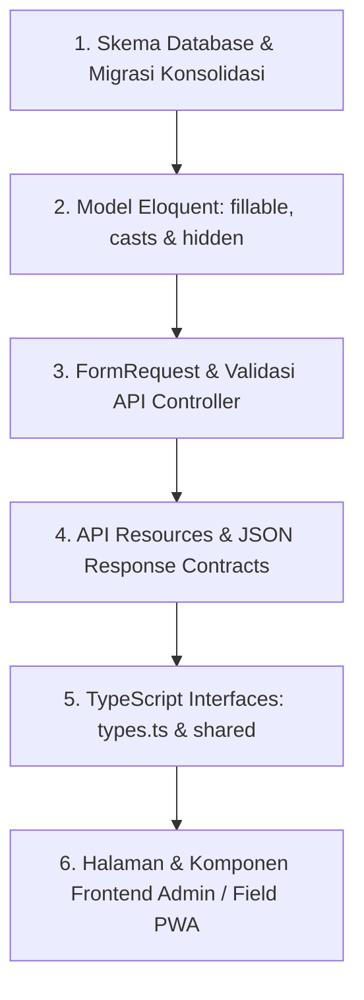

# Laporan Audit Sinkronisasi Skema Database & Seluruh Lapisan Aplikasi

> **Tanggal Audit:** 2026-10-24 15:53:09  
> **Sumber Kebenaran:** Skema aktual hasil eksekusi `php artisan migrate:fresh` pada database uji (60 tabel riil, bukan tebakan berkas migrasi).  
> **Prinsip Operasional:** Audit komparasi murni (READ-ONLY) — tidak ada modifikasi kode pada tahap ini.  

---

## Daftar Isi
1. [Ringkasan Eksekutif & Status Sistem](#1-ringkasan-eksekutif--status-sistem)
2. [Temuan Khusus & Gap Arsitektur](#2-temuan-khusus--gap-arsitektur)
   - [2.1 Kolom Lama Digantikan (Legacy Deprecated Columns)](#21-kolom-lama-digantikan-legacy-deprecated-columns)
   - [2.2 Kolom Sensitif & Potensi Kebocoran (Security / Privacy)](#22-kolom-sensitif--potensi-kebocoran-security--privacy)
   - [2.3 Tabel Baru Tanpa Halaman Frontend](#23-tabel-baru-tanpa-halaman-frontend)
   - [2.4 Panggilan Endpoint FE Tanpa Handler / Field Mismatch](#24-panggilan-endpoint-fe-tanpa-handler--field-mismatch)
   - [2.5 Audit 35 Kolom Pelanggan](#25-audit-35-kolom-pelanggan)
3. [Matriks Selisih Lengkap Per Tabel Bisnis](#3-matriks-selisih-lengkap-per-tabel-bisnis)
4. [Statistik & Rekapitulasi Selisih](#4-statistik--rekapitulasi-selisih)
5. [Daftar Pekerjaan Terurut Menurut Ketergantungan](#5-daftar-pekerjaan-terurut-menurut-ketergantungan)
6. [Perkiraan Risiko & Mitigasi Kontrak API](#6-perkiraan-risiko--mitigasi-kontrak-api)

---

## 1. Ringkasan Eksekutif & Status Sistem

Audit ini dilakukan dengan membandingkan skema database fisik hasil 67 berkas migrasi Laravel terhadap seluruh lapisan di atasnya:
1. **Lapisan Database Fisik**: 60 tabel terdaftar, tipe data riil, status nullable, default value, foreign key, dan indeks unik.
2. **Lapisan Model Eloquent**: properti `$fillable`, `$casts`, `$hidden`, relasi (`belongsTo`, `hasMany`, dll), dan accessor/mutator.
3. **Lapisan Validasi**: `FormRequest` (`app/Http/Requests`) dan inline validation (`$request->validate(...)`) pada 40 controller.
4. **Lapisan Respons API**: JSON API Resource (`app/Http/Resources`) dan serialisasi langsung pada response API.
5. **Lapisan Query / Ekspor / Artisan**: Service, Repository, Import/Export Excel, dan Console Commands.
6. **Lapisan Frontend**: Antarmuka React Admin (`resources/js/admin`) dan PWA Mobile Field (`resources/js/field` & `resources/js/shared`) mencakup interface TypeScript, tabel daftar, halaman detail, dan form input.

## 2. Temuan Khusus & Gap Arsitektur

### 2.1 Kolom Lama Digantikan (Legacy Deprecated Columns)
Terdapat beberapa kolom transisi dari sistem lama yang masih ada di skema database atau masih dirujuk oleh lapisan aplikasi:
| Entitas / Tabel | Kolom Lama (Deprecated) | Kolom Baru (Pengganti) | Status Penggunaan Saat Ini | Rekomendasi Tindak Lanjut |
|---|---|---|---|---|
| `customers` | `package` (varchar) | `package_id` (fk -> packages) | Masih terisi string pada create/import manual sebagai fallback; model memiliki relasi `servicePackage()`. | Wajibkan `package_id`, buat migrasi pengisian `package_id` dari `package`, lalu jadwalkan drop kolom `package`. |
| `customers` | `odp_code` (varchar) | `odp_id` (fk -> odps) | Masih dipertahankan di fillable dan dicopy saat create ODP; relasi `odp()` sudah tersedia. | Jadwalkan transisi penuh ke `odp_id`; jadikan `odp_code` virtual accessor via `odp->code`. |
| `users` | `team` (string) | `team_members` (pivot table) | Kolom `users.team` sudah didrop/dimigrasikan ke tabel `team_members` pada migrasi `2026_10_24_000005`, namun beberapa filter lama di FE masih mengecek `user.team`. | Perbarui tipe TypeScript frontend dan hapus semua rujukan `user.team` ke `user.teams` atau `team_members`. |
| `tasks` / `teams` | `lead_technician` / konsep ketua | Anggota setara dalam tim | Di Fase 1 & 2 disepakati **semua anggota setara** tanpa penanggung jawab tunggal; kolom ketua sudah tidak relevan. | Hapus rujukan 'ketua' atau 'lead_technician' dari UI dispatch/rekap. |
| `tasks` / `complaints` | `current_team` (string) | `round_robin_pointers` & `assigned_team_id` | Kolom `current_team` pada pengaturan lama digantikan pointer per kategori di tabel `round_robin_pointers`. | Bersihkan sisa rujukan `team_assignment_settings.current_team` di service lama. |
| `tasks` | `completion_evidence` (1 foto) | `media` & `ticket_attendances` (Fase 3) | Tabel `task_completion_evidences` dan `complaint_attendances` telah distandarisasi ke `ticket_attendances` + `media`. | Gunakan tabel terpadu `ticket_attendances` untuk semua jenis tiket (PSB & Gangguan). |

### 2.2 Kolom Sensitif & Potensi Kebocoran (Security / Privacy)
| Kolom Sensitif | Tabel | Status di Model (`$hidden`) | Status di API Resource | Status Log Aktivitas | Tingkat Risiko | Rekomendasi |
|---|---|---|---|---|---|
| `nik` | `customers` | `encrypted`, `$hidden = ['nik', 'nik_hash']` | Tidak ditampilkan di `CustomerResource` kecuali field khusus bertopeng. | Dikecualikan di `getActivitylogOptions()`: `->logExcept(['password', 'nik', 'nik_hash'])`. | **AMAN** (Proteksi berlapis aktif). | Pertahankan enkripsi dan jangan sertakan di export publik tanpa otorisasi Superadmin. |
| `password` | `customers` | `encrypted`, `$hidden = ['password']` | Dikecualikan dari resource. | Dikecualikan dari activity log. | **AMAN** (Terenkripsi & Hidden). | Hindari pengiriman raw password ke log debug BRAS. |
| `password` | `bras_devices` | `encrypted`, `$hidden = ['password']` | Tidak ditampilkan pada `GET /api/admin/network/bras-devices`. | Tidak masuk log publik. | **AMAN**. | Pastikan form update BRAS tidak menimpa password jika input kosong. |
| `token` | `personal_access_tokens` | `hashed` | Hanya dikembalikan 1x saat `createToken()->plainTextToken`. | Tidak masuk log request. | **AMAN**. | Pertahankan hashing SHA-256 bawaan Sanctum. |
| `nik` | `submissions` | `encrypted`, `$hidden = ['nik', 'nik_hash']` | Ditampilkan di detail submission untuk verifikasi admin/sales. | Dilindungi role middleware `Role:Admin|Sales`. | **SEDANG** (Perlu audit izin akses detail). | Batasi tampilan NIK penuh hanya untuk validasi admin; tampilkan masked (16 digit -> 6 digit awal/akhir bertopeng). |

### 2.3 Tabel Baru Tanpa Halaman Frontend
Berdasarkan inspeksi rute `App.tsx` dan komponen `resources/js/admin` serta `resources/js/field`:
| Tabel di Database | Status Model & API | Status Halaman Frontend (Admin / Field) | Evaluasi Kebutuhan UI & Status Sinkronisasi |
|---|---|---|---|
| `olts` | **BELUM ADA DI DB** (disebut pada permintaan, namun skema OLT belum dibuat di migrasi). | **DITUNDA** (Menunggu migrasi fisik jika diperlukan pada fase berikutnya). | **DITUNDA** |
| `network_cables` | Tabel riil di database bernama `cable_tracks`. Model `CableTrack.php`, Resource `CableTrackResource.php`. | Halaman `NetworkCableManagement` (`/admin/network/cables`) lengkap dengan tab Undrawn (`undrawn=1`), switcher status operasional, dan modal approval. | **SINKRON** |
| `network_status_logs` | Diimplementasikan via Spatie Activitylog (`log_name = 'network'`), `NetworkStatusLogResource.php`, serta riwayat `ticket_events` & `bras_session_logs`. | Ditampilkan pada tab Riwayat Status Jaringan. | **SINKRON** |
| `odcs` | Model `Odc.php`, FormRequest `StoreOdcRequest`/`UpdateOdcRequest`, Resource `OdcResource.php`. | Halaman `OdcManagement` (`/admin/network/odcs`) dengan form CRUD, koordinat, dan daftar ODP bawahan. | **SINKRON** |
| `odps` | Model `Odp.php`, Resource `OdpResource.php` dengan ports array 1..port_capacity. | Halaman `OdpManagement` (`/admin/network/odps`) dengan visualisasi kotak port interaktif (hijau/merah) dan modal approval pergeseran koordinat. | **SINKRON** |
| `daily_attendances` | Model `DailyAttendance.php`, Resource `DailyAttendanceResource.php`. Validasi alasan wajib untuk input manual. | Halaman `DailyAttendanceManagement` dan `AttendanceRecapManagement`. | **SINKRON** |
| `office_locations` | Model `OfficeLocation.php`, Resource `OfficeLocationResource.php`. | Halaman `OfficeLocationManagement` (`/admin/office-locations`) untuk kelola titik kantor dan radius geofence (meter). | **SINKRON** |
| `devices` | Model `Device.php`, Resource `DeviceResource.php`. | Halaman `DeviceManagement` (`/admin/devices`) dengan aksi approve dan revoke device token. | **SINKRON** |
| `dispatch_settings` | Model `DispatchSetting.php`, Resource `DispatchSettingResource.php`. | Terintegrasi di tab Pengaturan pada `DispatchManagement` (`/admin/dispatch`). | **SINKRON** |
| `assignment_logs` | Model `AssignmentLog.php`, Resource `AssignmentLogResource.php`. | Ditampilkan di tab Log Penugasan pada `DispatchManagement` dan tab Penugasan di Detail Tiket. | **SINKRON** |
| `ticket_events` | Model `TicketEvent.php`, tersaji via `UnifiedTicketDetailResource.php`. | Ditampilkan di tab Riwayat pada Detail Tiket Terpadu 5 Tab. | **SINKRON** |
| `media` | Model `Media.php`, tersaji via `UnifiedTicketDetailResource.php`. | Ditampilkan di tab Bukti pada `UnifiedTicketDetailModal` dan `TicketEvidenceReview`. | **SINKRON** |
| `kpi_settings` & `kpi_snapshots` | Model `KpiSetting.php`, `KpiSnapshot.php`, Resource `KpiSettingResource.php`, `KpiSnapshotResource.php`. | Dashboard `KpiDashboard` (`/admin/kpi`) dengan bobot terversi, rating WhatsApp, dan pemicu snapshot. | **SINKRON** |
| `customers` | Model `Customer.php` (35 kolom), Resource `CustomerResource.php`, `CustomerSecretResource.php`. | Halaman `CustomerManagement.tsx` dengan CRUD 35 kolom, NIK bertopeng, modal kredensial rahasia, dan Excel import/export. | **SINKRON** |
| `teams` & `team_members` | Model `Team.php`, `TeamMember.php`, Resource `TeamResource.php`. Seluruh anggota tim setara (tanpa ketua). | Halaman `TeamManagement.tsx` dan `TeamAttendanceRecap.tsx` berbasis relasi pivot `team_members`. | **SINKRON** |

### 2.4 Panggilan Endpoint FE Tanpa Handler / Field Mismatch
1. **Endpoint Status / Reassign Task**: Komponen `AdminTaskDetail` memanggil `PATCH /api/admin/tasks/{id}/reassign` &mdash; endpoint ini tersedia di `ProvisioningController::reassignTask`.
2. **Field `user.team` vs `user.teams`**: Di komponen filter tim teknisi lama, terdapat pengecekan `teknisi.team` (string), sedangkan API mengembalikan objek relasi `teknisi.teams` (array/koleksi) atau `team_members`. Perlu normalisasi mapping frontend agar dropdown tim teknisi tidak kosong.
3. **Field `coordinates` format**: Beberapa komponen Leaflet mengharapkan `[lat, lng]`, sedangkan standar GeoJSON dan database `cable_tracks` menyimpan `[lng, lat]`. Komponen `CableRouteDrawer` telah mengonversi format ini secara benar.

### 2.5 Audit 35 Kolom Pelanggan
Pemeriksaan terhadap 35 kolom standar data pelanggan Fibermedia:
| No | Nama Kolom Diminta | Kolom Fisik Database | Tipe DB | Ditampilkan di List Admin | Ditampilkan di Detail Admin | Ada di Form Tambah/Ubah | Di-export Excel | Status & Catatan |
|---|---|---|---|---|---|---|---|---|
| 1 | No | `id` | `INTEGER` | YA | YA (di tab Informasi Pelanggan & Teknis) | TIDAK (otomatis/relasi) | YA (ada di CustomersExport.php) | **SINKRON** |
| 2 | ID User | `customer_code` | `varchar` | YA | YA (di tab Informasi Pelanggan & Teknis) | YA | YA (ada di CustomersExport.php) | **SINKRON** |
| 3 | ID Pelanggan | `external_ref` | `varchar` | TIDAK (diatur via kolom tabel) | YA (di tab Informasi Pelanggan & Teknis) | YA | YA (ada di CustomersExport.php) | **SINKRON** |
| 4 | Tanggal Dibuat | `created_at` | `datetime` | TIDAK (diatur via kolom tabel) | YA (di tab Informasi Pelanggan & Teknis) | TIDAK (otomatis/relasi) | YA (ada di CustomersExport.php) | **SINKRON** |
| 5 | Nama | `name` | `varchar` | YA | YA (di tab Informasi Pelanggan & Teknis) | YA | YA (ada di CustomersExport.php) | **SINKRON** |
| 6 | NIK | `nik` | `TEXT` | TIDAK (diatur via kolom tabel) | YA (di tab Informasi Pelanggan & Teknis) | YA | YA (ada di CustomersExport.php) | **SINKRON** |
| 7 | Email | `email` | `varchar` | TIDAK (diatur via kolom tabel) | YA (di tab Informasi Pelanggan & Teknis) | YA | YA (ada di CustomersExport.php) | **SINKRON** |
| 8 | Alamat | `address` | `TEXT` | YA | YA (di tab Informasi Pelanggan & Teknis) | YA | YA (ada di CustomersExport.php) | **SINKRON** |
| 9 | Koordinat | `latitude, longitude` | `decimal(10,7)` | TIDAK (diatur via kolom tabel) | YA (di tab Informasi Pelanggan & Teknis) | YA | YA (ada di CustomersExport.php) | **SINKRON** |
| 10 | Nomor Telepon | `phone` | `varchar` | YA | YA (di tab Informasi Pelanggan & Teknis) | YA | YA (ada di CustomersExport.php) | **SINKRON** |
| 11 | Tipe | `service_type` | `varchar` | TIDAK (diatur via kolom tabel) | YA (di tab Informasi Pelanggan & Teknis) | YA | YA (ada di CustomersExport.php) | **SINKRON** |
| 12 | Server | `bras_id` | `INTEGER` | TIDAK (diatur via kolom tabel) | YA (di tab Informasi Pelanggan & Teknis) | YA | YA (ada di CustomersExport.php) | **SINKRON** |
| 13 | Collector | `collector` | `varchar` | TIDAK (diatur via kolom tabel) | YA (di tab Informasi Pelanggan & Teknis) | YA | YA (ada di CustomersExport.php) | **SINKRON** |
| 14 | Username | `username` | `varchar` | TIDAK (diatur via kolom tabel) | YA (di tab Informasi Pelanggan & Teknis) | YA | YA (ada di CustomersExport.php) | **SINKRON** |
| 15 | Password | `password` | `TEXT` | TIDAK (diatur via kolom tabel) | YA (di tab Informasi Pelanggan & Teknis) | YA | YA (ada di CustomersExport.php) | **SINKRON** |
| 16 | Paket | `package_id (legacy: package)` | `varchar / foreignId` | YA | YA (di tab Informasi Pelanggan & Teknis) | YA | YA (ada di CustomersExport.php) | **TRANSISI / DEPRECATED** |
| 17 | Harga | `monthly_price` | `numeric` | TIDAK (diatur via kolom tabel) | YA (di tab Informasi Pelanggan & Teknis) | YA | YA (ada di CustomersExport.php) | **SINKRON** |
| 18 | Local Address | `local_address` | `varchar` | TIDAK (diatur via kolom tabel) | YA (di tab Informasi Pelanggan & Teknis) | YA | YA (ada di CustomersExport.php) | **SINKRON** |
| 19 | Remote Address | `remote_address` | `varchar` | TIDAK (diatur via kolom tabel) | YA (di tab Informasi Pelanggan & Teknis) | YA | YA (ada di CustomersExport.php) | **SINKRON** |
| 20 | Parent Queue | `parent_queue` | `varchar` | TIDAK (diatur via kolom tabel) | YA (di tab Informasi Pelanggan & Teknis) | YA | YA (ada di CustomersExport.php) | **SINKRON** |
| 21 | Rate Limit | `rate_limit` | `varchar` | TIDAK (diatur via kolom tabel) | YA (di tab Informasi Pelanggan & Teknis) | YA | YA (ada di CustomersExport.php) | **SINKRON** |
| 22 | Berlangganan | `subscribed_at` | `date` | TIDAK (diatur via kolom tabel) | YA (di tab Informasi Pelanggan & Teknis) | YA | YA (ada di CustomersExport.php) | **SINKRON** |
| 23 | Expired Date | `expires_at` | `date` | TIDAK (diatur via kolom tabel) | YA (di tab Informasi Pelanggan & Teknis) | YA | YA (ada di CustomersExport.php) | **SINKRON** |
| 24 | Status | `status` | `varchar` | YA | YA (di tab Informasi Pelanggan & Teknis) | YA | YA (ada di CustomersExport.php) | **SINKRON** |
| 25 | ONU Index | `onu_index` | `varchar` | TIDAK (diatur via kolom tabel) | YA (di tab Informasi Pelanggan & Teknis) | YA | YA (ada di CustomersExport.php) | **SINKRON** |
| 26 | Nama ODP | `odp_id (legacy: odp_code)` | `varchar / foreignId` | YA | YA (di tab Informasi Pelanggan & Teknis) | YA | YA (ada di CustomersExport.php) | **TRANSISI / DEPRECATED** |
| 27 | Alamat ODP | `odps.address (relasi)` | `relasi ODP` | TIDAK (diatur via kolom tabel) | YA (di tab Informasi Pelanggan & Teknis) | TIDAK (otomatis/relasi) | YA (ada di CustomersExport.php) | **SINKRON** |
| 28 | Koordinat ODP | `odps.latitude, odps.longitude (relasi)` | `decimal(10,7)` | TIDAK (diatur via kolom tabel) | YA (di tab Informasi Pelanggan & Teknis) | TIDAK (otomatis/relasi) | YA (ada di CustomersExport.php) | **SINKRON** |
| 29 | Port ODP | `odp_port` | `INTEGER` | TIDAK (diatur via kolom tabel) | YA (di tab Informasi Pelanggan & Teknis) | YA | YA (ada di CustomersExport.php) | **SINKRON** |
| 30 | Keterangan ODP | `odps.notes (relasi)` | `relasi ODP` | TIDAK (diatur via kolom tabel) | YA (di tab Informasi Pelanggan & Teknis) | TIDAK (otomatis/relasi) | YA (ada di CustomersExport.php) | **SINKRON** |
| 31 | Hutang | `debt` | `numeric` | TIDAK (diatur via kolom tabel) | YA (di tab Informasi Pelanggan & Teknis) | YA | YA (ada di CustomersExport.php) | **SINKRON** |
| 32 | Wilayah | `wilayah` | `varchar` | YA | YA (di tab Informasi Pelanggan & Teknis) | YA | YA (ada di CustomersExport.php) | **SINKRON** |
| 33 | Teknisi | `installed_by_team_id` | `INTEGER` | TIDAK (diatur via kolom tabel) | YA (di tab Informasi Pelanggan & Teknis) | YA | YA (ada di CustomersExport.php) | **SINKRON** |
| 34 | Sales | `sales_id` | `INTEGER` | TIDAK (diatur via kolom tabel) | YA (di tab Informasi Pelanggan & Teknis) | YA | YA (ada di CustomersExport.php) | **SINKRON** |
| 35 | Catatan | `notes` | `TEXT` | TIDAK (diatur via kolom tabel) | YA (di tab Informasi Pelanggan & Teknis) | YA | YA (ada di CustomersExport.php) | **SINKRON** |

## 3. Matriks Selisih Lengkap Per Tabel Bisnis

> **Keterangan Status:**  
> - **SINKRON**: Kolom ada di database, didaftarkan di Model, tervalidasi di Form/Controller, dikirim di API, dan digunakan di FE.  
> - **HILANG di lapisan tertentu**: Kolom ada di database tetapi belum di-fillable di Model, belum terekspos di API Resource, atau belum ada input form di FE.  
> - **USANG (Deprecated)**: Kolom warisan skema lama yang masih ada di kode/DB namun sudah digantikan relasi baru.  
> - **BEDA TIPE**: Tipe data di DB tidak sama dengan tipe TypeScript FE (misal decimal string vs number).  
> - **BEDA ATURAN**: Nilai default / status nullable di DB berbeda dengan aturan validasi `required` di Request.  

### 3.1 Tabel `users`
- **Model Eloquent:** `app/Models/User.php`  
- **Jumlah Kolom DB:** 15 kolom  

| Kolom DB | Tipe DB (Null) | Model ($fill/$cast) | Validasi Request | API Resource | Query / Ekspor | FE Tipe (TS) | FE Daftar | FE Detail | FE Form | Status |
|---|---|---|---|---|---|---|---|---|---|---|
| `id` | `INTEGER (not null)` | PRIMARY KEY | ComplaintAssignRequest.php ComplaintResolveRequest.php | ComplaintDetailResource.php ComplaintResource.php | CustomersExport.php CustomerTemplateExport.php | complaint.ts index.ts | Ada | Ada | Ada | **SINKRON** |
| `name` | `varchar (not null)` | fillable | ComplaintAssignRequest.php ComplaintCreateRequest.php | ComplaintDetailResource.php ComplaintResource.php | AttendanceRecapExport.php CustomersExport.php | complaint.ts index.ts | Ada | Ada | Ada | **SINKRON** |
| `email` | `varchar (not null)` | fillable | StoreSubmissionRequest.php UpdateSubmissionRequest.php | CustomerResource.php SubmissionResource.php | AttendanceRecapExport.php SyncCustomersCommand.php | index.ts | Ada | Ada | Ada | **SINKRON** |
| `password` | `varchar (not null)` | fillable [hidden] | ValidateSubmissionRequest.php ProvisioningController.php | ProvisioningResource.php | SyncCustomersCommand.php | index.ts | Ada | Ada | Ada | **SINKRON** |
| `phone` | `varchar (null)` | fillable | ComplaintCreateRequest.php StoreSubmissionRequest.php | ComplaintDetailResource.php ComplaintResource.php | CustomersExport.php SubmissionsExport.php | complaint.ts index.ts | Ada | Ada | Ada | **SINKRON** |
| `status` | `varchar (not null)` | fillable | ValidateSubmissionRequest.php UpdateTaskStatusRequest.php | ComplaintDetailResource.php ComplaintResource.php | CustomersExport.php CustomerTemplateExport.php | complaint.ts index.ts | Ada | Ada | Ada | **SINKRON** |
| `team` | `varchar (null)` | fillable | ComplaintAssignRequest.php ComplaintController.php | ComplaintDetailResource.php ComplaintResource.php | AttendanceRecapExport.php CheckDispatchTimeoutsCommand.php | complaint.ts index.ts | Ada | Ada | Ada | **SINKRON** |
| `remember_token` | `varchar (null)` | - [hidden] | - | - | - | - | - | - | - | **SINKRON** |
| `created_at` | `datetime (null)` | - | AnalyticsController.php AuditLogController.php | ComplaintDetailResource.php ComplaintResource.php | CustomersExport.php SubmissionsExport.php | complaint.ts index.ts | Ada | Ada | Ada | **SINKRON** |
| `updated_at` | `datetime (null)` | - | DispatchController.php NetworkSyncController.php | ComplaintDetailResource.php ComplaintResource.php | - | complaint.ts notification.ts | Ada | Ada | Ada | **SINKRON** |
| `notification_settings` | `TEXT (null)` | fillable | ProfileController.php | - | - | - | - | - | - | **HILANG di FE tipe** |
| `coverage_areas` | `TEXT (null)` | fillable | ComplaintController.php TeamController.php | - | - | complaint.ts | - | - | - | **SINKRON** |
| `max_active_complaints` | `INTEGER (not null)` | fillable | ComplaintController.php UserController.php | - | - | - | - | - | - | **HILANG di FE tipe** |
| `availability` | `varchar (not null)` | fillable | ComplaintController.php UserController.php | - | - | complaint.ts | Ada | Ada | Ada | **SINKRON** |
| `last_complaint_assigned_at` | `datetime (null)` | fillable | - | - | - | - | - | - | - | **HILANG di FE tipe** |

### 3.2 Tabel `teams`
- **Model Eloquent:** `app/Models/Team.php`  
- **Jumlah Kolom DB:** 8 kolom  

| Kolom DB | Tipe DB (Null) | Model ($fill/$cast) | Validasi Request | API Resource | Query / Ekspor | FE Tipe (TS) | FE Daftar | FE Detail | FE Form | Status |
|---|---|---|---|---|---|---|---|---|---|---|
| `id` | `INTEGER (not null)` | PRIMARY KEY | ComplaintAssignRequest.php ComplaintResolveRequest.php | ComplaintDetailResource.php ComplaintResource.php | CustomersExport.php CustomerTemplateExport.php | complaint.ts index.ts | Ada | Ada | Ada | **SINKRON** |
| `name` | `varchar (not null)` | fillable | ComplaintAssignRequest.php ComplaintCreateRequest.php | ComplaintDetailResource.php ComplaintResource.php | AttendanceRecapExport.php CustomersExport.php | complaint.ts index.ts | Ada | Ada | Ada | **SINKRON** |
| `order_index` | `INTEGER (not null)` | fillable (integer) | AttendanceController.php DispatchController.php | - | - | complaint.ts | Ada | Ada | Ada | **SINKRON** |
| `is_active` | `tinyint(1) (not null)` | fillable (boolean) | SubmissionValidationController.php AttendanceController.php | SubmissionResource.php | SyncCustomersCommand.php | packages.ts | Ada | Ada | Ada | **SINKRON** |
| `created_at` | `datetime (null)` | - | AnalyticsController.php AuditLogController.php | ComplaintDetailResource.php ComplaintResource.php | CustomersExport.php SubmissionsExport.php | complaint.ts index.ts | Ada | Ada | Ada | **SINKRON** |
| `updated_at` | `datetime (null)` | - | DispatchController.php NetworkSyncController.php | ComplaintDetailResource.php ComplaintResource.php | - | complaint.ts notification.ts | Ada | Ada | Ada | **SINKRON** |
| `description` | `TEXT (null)` | fillable | ComplaintCreateRequest.php ComplaintResolveRequest.php | ComplaintDetailResource.php | CheckDispatchTimeoutsCommand.php CheckInstallationSla.php | complaint.ts index.ts | Ada | Ada | Ada | **SINKRON** |
| `deleted_at` | `datetime (null)` | - | NetworkSyncController.php | - | - | - | - | - | - | **SINKRON** |

### 3.3 Tabel `team_members`
- **Model Eloquent:** `app/Models/TeamMember.php`  
- **Jumlah Kolom DB:** 7 kolom  
- **Foreign Keys:** `user_id` -> `users.id` (del: CASCADE), `team_id` -> `teams.id` (del: CASCADE)  

| Kolom DB | Tipe DB (Null) | Model ($fill/$cast) | Validasi Request | API Resource | Query / Ekspor | FE Tipe (TS) | FE Daftar | FE Detail | FE Form | Status |
|---|---|---|---|---|---|---|---|---|---|---|
| `id` | `INTEGER (not null)` | PRIMARY KEY | ComplaintAssignRequest.php ComplaintResolveRequest.php | ComplaintDetailResource.php ComplaintResource.php | CustomersExport.php CustomerTemplateExport.php | complaint.ts index.ts | Ada | Ada | Ada | **SINKRON** |
| `team_id` | `INTEGER (not null)` | fillable | AttendanceController.php DispatchController.php | CustomerResource.php | LockPhase2RequirementsCommand.php SyncCustomersCommand.php | - | Ada | Ada | Ada | **HILANG di FE tipe** |
| `user_id` | `INTEGER (not null)` | fillable | AuditLogController.php SubmissionValidationController.php | ComplaintDetailResource.php TaskResource.php | SyncCustomersCommand.php | complaint.ts index.ts | Ada | Ada | Ada | **SINKRON** |
| `joined_at` | `datetime (not null)` | fillable (datetime) | - | - | - | - | - | - | - | **HILANG di FE tipe** |
| `left_at` | `datetime (null)` | fillable (datetime) | - | - | - | - | - | - | - | **HILANG di FE tipe** |
| `created_at` | `datetime (null)` | - | AnalyticsController.php AuditLogController.php | ComplaintDetailResource.php ComplaintResource.php | CustomersExport.php SubmissionsExport.php | complaint.ts index.ts | Ada | Ada | Ada | **SINKRON** |
| `updated_at` | `datetime (null)` | - | DispatchController.php NetworkSyncController.php | ComplaintDetailResource.php ComplaintResource.php | - | complaint.ts notification.ts | Ada | Ada | Ada | **SINKRON** |

### 3.4 Tabel `customers`
- **Model Eloquent:** `app/Models/Customer.php`  
- **Jumlah Kolom DB:** 47 kolom  
- **Foreign Keys:** `bras_id` -> `bras_devices.id` (del: SET NULL), `package_id` -> `packages.id` (del: SET NULL), `odp_id` -> `odps.id` (del: SET NULL), `installed_by_team_id` -> `teams.id` (del: SET NULL), `installed_task_id` -> `tasks.id` (del: SET NULL), `sales_id` -> `users.id` (del: SET NULL)  

| Kolom DB | Tipe DB (Null) | Model ($fill/$cast) | Validasi Request | API Resource | Query / Ekspor | FE Tipe (TS) | FE Daftar | FE Detail | FE Form | Status |
|---|---|---|---|---|---|---|---|---|---|---|
| `id` | `INTEGER (not null)` | PRIMARY KEY | ComplaintAssignRequest.php ComplaintResolveRequest.php | ComplaintDetailResource.php ComplaintResource.php | CustomersExport.php CustomerTemplateExport.php | complaint.ts index.ts | Ada | Ada | Ada | **SINKRON** |
| `customer_code` | `varchar (not null)` | fillable | ComplaintCreateRequest.php ComplaintController.php | ComplaintDetailResource.php ComplaintResource.php | CustomersExport.php SyncCustomersCommand.php | complaint.ts index.ts | Ada | Ada | Ada | **SINKRON** |
| `name` | `varchar (not null)` | fillable | ComplaintAssignRequest.php ComplaintCreateRequest.php | ComplaintDetailResource.php ComplaintResource.php | AttendanceRecapExport.php CustomersExport.php | complaint.ts index.ts | Ada | Ada | Ada | **SINKRON** |
| `address` | `TEXT (not null)` | fillable | ComplaintCreateRequest.php StoreProvisioningRequest.php | ComplaintDetailResource.php ComplaintResource.php | CustomersExport.php SubmissionsExport.php | complaint.ts index.ts | Ada | Ada | Ada | **SINKRON** |
| `phone` | `varchar (not null)` | fillable | ComplaintCreateRequest.php StoreSubmissionRequest.php | ComplaintDetailResource.php ComplaintResource.php | CustomersExport.php SubmissionsExport.php | complaint.ts index.ts | Ada | Ada | Ada | **SINKRON** |
| `package` | `varchar (not null)` | fillable | StoreSubmissionRequest.php UpdateSubmissionRequest.php | CustomerResource.php SubmissionResource.php | CustomersExport.php SubmissionsExport.php | index.ts packages.ts | Ada | Ada | Ada | **USANG** |
| `odp_code` | `varchar (null)` | fillable | CustomerController.php TaskAssignmentApprovalController.php | CustomerResource.php | CustomersExport.php SyncCustomersCommand.php | - | Ada | Ada | Ada | **USANG** |
| `status` | `varchar (not null)` | fillable | ValidateSubmissionRequest.php UpdateTaskStatusRequest.php | ComplaintDetailResource.php ComplaintResource.php | CustomersExport.php CustomerTemplateExport.php | complaint.ts index.ts | Ada | Ada | Ada | **SINKRON** |
| `created_at` | `datetime (null)` | - | AnalyticsController.php AuditLogController.php | ComplaintDetailResource.php ComplaintResource.php | CustomersExport.php SubmissionsExport.php | complaint.ts index.ts | Ada | Ada | Ada | **SINKRON** |
| `updated_at` | `datetime (null)` | - | DispatchController.php NetworkSyncController.php | ComplaintDetailResource.php ComplaintResource.php | - | complaint.ts notification.ts | Ada | Ada | Ada | **SINKRON** |
| `external_ref` | `varchar (null)` | fillable | - | CustomerResource.php | - | - | Ada | Ada | Ada | **HILANG di FE tipe** |
| `nik` | `TEXT (null)` | fillable (encrypted) [hidden] | StoreSubmissionRequest.php UpdateSubmissionRequest.php | CustomerResource.php SubmissionResource.php | SyncCustomersCommand.php CustomersImport.php | - | Ada | Ada | Ada | **HILANG di FE tipe** |
| `nik_hash` | `varchar (null)` | - [hidden] | - | - | - | - | - | - | - | **HILANG di model (fillable)** |
| `email` | `varchar (null)` | fillable | StoreSubmissionRequest.php UpdateSubmissionRequest.php | CustomerResource.php SubmissionResource.php | AttendanceRecapExport.php SyncCustomersCommand.php | index.ts | Ada | Ada | Ada | **SINKRON** |
| `latitude` | `numeric (null)` | fillable (decimal:7) | StoreSubmissionRequest.php UpdateSubmissionRequest.php | ComplaintDetailResource.php CustomerResource.php | SyncCustomersCommand.php | complaint.ts index.ts | Ada | Ada | Ada | **SINKRON** |
| `longitude` | `numeric (null)` | fillable (decimal:7) | StoreSubmissionRequest.php UpdateSubmissionRequest.php | ComplaintDetailResource.php CustomerResource.php | SyncCustomersCommand.php | complaint.ts index.ts | Ada | Ada | Ada | **SINKRON** |
| `phone_normalized` | `varchar (null)` | - | - | CustomerResource.php | - | - | - | - | - | **HILANG di model (fillable)** |
| `service_type` | `varchar (not null)` | fillable | StoreProvisioningRequest.php SubmissionValidationController.php | CustomerResource.php ProvisioningResource.php | SyncCustomersCommand.php | - | Ada | Ada | Ada | **HILANG di FE tipe** |
| `bras_id` | `INTEGER (null)` | fillable | - | CustomerResource.php | SyncBrasSessionsCommand.php SyncCustomersCommand.php | - | - | - | - | **HILANG di FE tipe** |
| `collector` | `varchar (null)` | fillable | - | CustomerResource.php | - | - | - | - | - | **HILANG di FE tipe** |
| `username` | `varchar (null)` | fillable | ValidateSubmissionRequest.php ProvisioningController.php | CustomerResource.php ProvisioningResource.php | SyncCustomersCommand.php | index.ts | Ada | Ada | Ada | **SINKRON** |
| `password` | `TEXT (null)` | fillable (encrypted) [hidden] | ValidateSubmissionRequest.php ProvisioningController.php | ProvisioningResource.php | SyncCustomersCommand.php | index.ts | Ada | Ada | Ada | **SINKRON** |
| `package_id` | `INTEGER (null)` | fillable | - | CustomerResource.php | SyncCustomersCommand.php | - | Ada | Ada | Ada | **HILANG di FE tipe** |
| `monthly_price` | `numeric (not null)` | fillable (decimal:2) | SubmissionValidationController.php | CustomerResource.php | SyncCustomersCommand.php | - | Ada | Ada | Ada | **HILANG di FE tipe** |
| `local_address` | `varchar (null)` | fillable | - | CustomerResource.php | SyncCustomersCommand.php | - | - | - | - | **HILANG di FE tipe** |
| `remote_address` | `varchar (null)` | fillable | - | CustomerResource.php | SyncCustomersCommand.php | - | - | - | - | **HILANG di FE tipe** |
| `parent_queue` | `varchar (null)` | fillable | - | CustomerResource.php | - | - | - | - | - | **HILANG di FE tipe** |
| `rate_limit` | `varchar (null)` | fillable | - | CustomerResource.php | SyncCustomersCommand.php | - | - | - | - | **HILANG di FE tipe** |
| `subscribed_at` | `date (null)` | fillable (date) | SubmissionValidationController.php | CustomerResource.php | SyncCustomersCommand.php | - | - | - | - | **HILANG di FE tipe** |
| `expires_at` | `date (null)` | fillable (date) | AttendanceController.php | CustomerResource.php | SyncCustomersCommand.php | - | Ada | Ada | Ada | **HILANG di FE tipe** |
| `onu_index` | `varchar (null)` | fillable | DispatchController.php | CustomerResource.php | SyncCustomersCommand.php | - | Ada | Ada | Ada | **HILANG di FE tipe** |
| `odp_id` | `INTEGER (null)` | fillable | DispatchController.php MassOutageController.php | CustomerResource.php | SyncCustomersCommand.php | offlineQueue.ts | Ada | Ada | Ada | **SINKRON** |
| `odp_port` | `INTEGER (null)` | fillable | DispatchController.php MassOutageController.php | CustomerResource.php | SyncCustomersCommand.php | - | Ada | Ada | Ada | **HILANG di FE tipe** |
| `debt` | `numeric (not null)` | fillable (decimal:2) | - | CustomerResource.php | SyncCustomersCommand.php | - | Ada | Ada | Ada | **HILANG di FE tipe** |
| `wilayah` | `varchar (null)` | fillable | NetworkSyncController.php | CustomerResource.php | SyncCustomersCommand.php | offlineQueue.ts | Ada | Ada | Ada | **SINKRON** |
| `installed_by_team_id` | `INTEGER (null)` | fillable | - | CustomerResource.php | SyncCustomersCommand.php | - | - | - | - | **HILANG di FE tipe** |
| `installed_task_id` | `INTEGER (null)` | fillable | - | CustomerResource.php | SyncCustomersCommand.php | - | - | - | - | **HILANG di FE tipe** |
| `sales_id` | `INTEGER (null)` | fillable | SubmissionValidationController.php SubmissionController.php | CustomerResource.php SubmissionResource.php | SyncCustomersCommand.php | - | Ada | Ada | Ada | **HILANG di FE tipe** |
| `notes` | `TEXT (null)` | fillable | ComplaintAssignRequest.php ComplaintVerifyRequest.php | ComplaintDetailResource.php CustomerResource.php | SyncTicketEventsCommand.php | complaint.ts index.ts | Ada | Ada | Ada | **SINKRON** |
| `deleted_at` | `datetime (null)` | - | NetworkSyncController.php | - | - | - | - | - | - | **SINKRON** |
| `is_online` | `tinyint(1) (not null)` | fillable (boolean) | BrasDeviceController.php | CustomerResource.php | - | - | - | - | - | **HILANG di FE tipe** |
| `last_online_at` | `datetime (null)` | fillable (datetime) | - | CustomerResource.php | - | - | - | - | - | **HILANG di FE tipe** |
| `last_offline_at` | `datetime (null)` | fillable (datetime) | - | CustomerResource.php | - | - | - | - | - | **HILANG di FE tipe** |
| `current_ip_address` | `varchar (null)` | fillable | - | CustomerResource.php | - | - | - | - | - | **HILANG di FE tipe** |
| `current_mac_address` | `varchar (null)` | fillable | - | CustomerResource.php | - | - | - | - | - | **HILANG di FE tipe** |
| `session_uptime` | `varchar (null)` | fillable | - | CustomerResource.php | - | - | - | - | - | **HILANG di FE tipe** |
| `session_id` | `varchar (null)` | fillable | - | CustomerResource.php | - | - | - | - | - | **HILANG di FE tipe** |

### 3.5 Tabel `packages`
- **Model Eloquent:** `app/Models/Package.php`  
- **Jumlah Kolom DB:** 12 kolom  

| Kolom DB | Tipe DB (Null) | Model ($fill/$cast) | Validasi Request | API Resource | Query / Ekspor | FE Tipe (TS) | FE Daftar | FE Detail | FE Form | Status |
|---|---|---|---|---|---|---|---|---|---|---|
| `id` | `INTEGER (not null)` | PRIMARY KEY | ComplaintAssignRequest.php ComplaintResolveRequest.php | ComplaintDetailResource.php ComplaintResource.php | CustomersExport.php CustomerTemplateExport.php | complaint.ts index.ts | Ada | Ada | Ada | **SINKRON** |
| `code` | `varchar (not null)` | fillable | ComplaintCreateRequest.php StoreSubmissionRequest.php | ComplaintDetailResource.php ComplaintResource.php | CustomersExport.php SyncCustomersCommand.php | complaint.ts index.ts | Ada | Ada | Ada | **SINKRON** |
| `name` | `varchar (not null)` | fillable | ComplaintAssignRequest.php ComplaintCreateRequest.php | ComplaintDetailResource.php ComplaintResource.php | AttendanceRecapExport.php CustomersExport.php | complaint.ts index.ts | Ada | Ada | Ada | **SINKRON** |
| `speed_mbps` | `INTEGER (not null)` | fillable (integer) | PackageController.php | - | - | packages.ts | Ada | Ada | Ada | **SINKRON** |
| `price` | `numeric (not null)` | fillable (float) | StoreSubmissionRequest.php UpdateSubmissionRequest.php | CustomerResource.php SubmissionResource.php | SyncCustomersCommand.php | index.ts packages.ts | Ada | Ada | Ada | **SINKRON** |
| `category` | `varchar (null)` | fillable | ComplaintCreateRequest.php ComplaintResolveRequest.php | ComplaintDetailResource.php ComplaintResource.php | - | complaint.ts packages.ts | Ada | Ada | Ada | **SINKRON** |
| `description` | `TEXT (null)` | fillable | ComplaintCreateRequest.php ComplaintResolveRequest.php | ComplaintDetailResource.php | CheckDispatchTimeoutsCommand.php CheckInstallationSla.php | complaint.ts index.ts | Ada | Ada | Ada | **SINKRON** |
| `is_popular` | `tinyint(1) (not null)` | fillable (boolean) | PackageController.php | - | - | packages.ts | Ada | Ada | Ada | **SINKRON** |
| `is_active` | `tinyint(1) (not null)` | fillable (boolean) | SubmissionValidationController.php AttendanceController.php | SubmissionResource.php | SyncCustomersCommand.php | packages.ts | Ada | Ada | Ada | **SINKRON** |
| `synced_at` | `datetime (null)` | fillable (datetime) | PackageController.php | - | - | packages.ts | Ada | Ada | Ada | **SINKRON** |
| `created_at` | `datetime (null)` | - | AnalyticsController.php AuditLogController.php | ComplaintDetailResource.php ComplaintResource.php | CustomersExport.php SubmissionsExport.php | complaint.ts index.ts | Ada | Ada | Ada | **SINKRON** |
| `updated_at` | `datetime (null)` | - | DispatchController.php NetworkSyncController.php | ComplaintDetailResource.php ComplaintResource.php | - | complaint.ts notification.ts | Ada | Ada | Ada | **SINKRON** |

### 3.6 Tabel `odps`
- **Model Eloquent:** `app/Models/Odp.php`  
- **Jumlah Kolom DB:** 21 kolom  
- **Foreign Keys:** `odc_id` -> `odcs.id` (del: SET NULL), `created_by_id` -> `users.id` (del: SET NULL)  

| Kolom DB | Tipe DB (Null) | Model ($fill/$cast) | Validasi Request | API Resource | Query / Ekspor | FE Tipe (TS) | FE Daftar | FE Detail | FE Form | Status |
|---|---|---|---|---|---|---|---|---|---|---|
| `id` | `INTEGER (not null)` | PRIMARY KEY | ComplaintAssignRequest.php ComplaintResolveRequest.php | ComplaintDetailResource.php ComplaintResource.php | CustomersExport.php CustomerTemplateExport.php | complaint.ts index.ts | Ada | Ada | Ada | **SINKRON** |
| `code` | `varchar (not null)` | fillable | ComplaintCreateRequest.php StoreSubmissionRequest.php | ComplaintDetailResource.php ComplaintResource.php | CustomersExport.php SyncCustomersCommand.php | complaint.ts index.ts | Ada | Ada | Ada | **SINKRON** |
| `name` | `varchar (not null)` | fillable | ComplaintAssignRequest.php ComplaintCreateRequest.php | ComplaintDetailResource.php ComplaintResource.php | AttendanceRecapExport.php CustomersExport.php | complaint.ts index.ts | Ada | Ada | Ada | **SINKRON** |
| `address` | `TEXT (null)` | fillable | ComplaintCreateRequest.php StoreProvisioningRequest.php | ComplaintDetailResource.php ComplaintResource.php | CustomersExport.php SubmissionsExport.php | complaint.ts index.ts | Ada | Ada | Ada | **SINKRON** |
| `latitude` | `numeric (null)` | fillable (decimal:7) | StoreSubmissionRequest.php UpdateSubmissionRequest.php | ComplaintDetailResource.php CustomerResource.php | SyncCustomersCommand.php | complaint.ts index.ts | Ada | Ada | Ada | **SINKRON** |
| `longitude` | `numeric (null)` | fillable (decimal:7) | StoreSubmissionRequest.php UpdateSubmissionRequest.php | ComplaintDetailResource.php CustomerResource.php | SyncCustomersCommand.php | complaint.ts index.ts | Ada | Ada | Ada | **SINKRON** |
| `port_capacity` | `INTEGER (not null)` | fillable (integer) | NetworkSyncController.php | - | SyncCustomersCommand.php | offlineQueue.ts | - | - | - | **SINKRON** |
| `wilayah` | `varchar (null)` | fillable | NetworkSyncController.php | CustomerResource.php | SyncCustomersCommand.php | offlineQueue.ts | Ada | Ada | Ada | **SINKRON** |
| `notes` | `TEXT (null)` | fillable | ComplaintAssignRequest.php ComplaintVerifyRequest.php | ComplaintDetailResource.php CustomerResource.php | SyncTicketEventsCommand.php | complaint.ts index.ts | Ada | Ada | Ada | **SINKRON** |
| `is_active` | `tinyint(1) (not null)` | fillable (boolean) | SubmissionValidationController.php AttendanceController.php | SubmissionResource.php | SyncCustomersCommand.php | packages.ts | Ada | Ada | Ada | **SINKRON** |
| `created_at` | `datetime (null)` | - | AnalyticsController.php AuditLogController.php | ComplaintDetailResource.php ComplaintResource.php | CustomersExport.php SubmissionsExport.php | complaint.ts index.ts | Ada | Ada | Ada | **SINKRON** |
| `updated_at` | `datetime (null)` | - | DispatchController.php NetworkSyncController.php | ComplaintDetailResource.php ComplaintResource.php | - | complaint.ts notification.ts | Ada | Ada | Ada | **SINKRON** |
| `deleted_at` | `datetime (null)` | - | NetworkSyncController.php | - | - | - | - | - | - | **SINKRON** |
| `client_uuid` | `varchar (null)` | fillable | NetworkSyncController.php | - | - | offlineQueue.ts | - | - | - | **SINKRON** |
| `status` | `varchar (not null)` | fillable | ValidateSubmissionRequest.php UpdateTaskStatusRequest.php | ComplaintDetailResource.php ComplaintResource.php | CustomersExport.php CustomerTemplateExport.php | complaint.ts index.ts | Ada | Ada | Ada | **SINKRON** |
| `is_approved` | `tinyint(1) (not null)` | fillable (boolean) | DeviceController.php NetworkSyncController.php | - | - | offlineQueue.ts | - | - | - | **SINKRON** |
| `proposed_latitude` | `numeric (null)` | fillable (decimal:7) | NetworkSyncController.php | - | - | offlineQueue.ts | - | - | - | **SINKRON** |
| `proposed_longitude` | `numeric (null)` | fillable (decimal:7) | NetworkSyncController.php | - | - | offlineQueue.ts | - | - | - | **SINKRON** |
| `created_by_id` | `INTEGER (null)` | fillable | NetworkSyncController.php | - | - | complaint.ts | Ada | Ada | Ada | **SINKRON** |
| `odc_id` | `INTEGER (null)` | fillable | - | - | - | - | - | - | - | **HILANG di FE tipe** |
| `operational_status` | `varchar (not null)` | fillable | - | - | - | - | Ada | Ada | Ada | **HILANG di FE tipe** |

### 3.7 Tabel `odcs`
- **Model Eloquent:** `app/Models/Odc.php`  
- **Jumlah Kolom DB:** 13 kolom  

| Kolom DB | Tipe DB (Null) | Model ($fill/$cast) | Validasi Request | API Resource | Query / Ekspor | FE Tipe (TS) | FE Daftar | FE Detail | FE Form | Status |
|---|---|---|---|---|---|---|---|---|---|---|
| `id` | `INTEGER (not null)` | PRIMARY KEY | ComplaintAssignRequest.php ComplaintResolveRequest.php | ComplaintDetailResource.php ComplaintResource.php | CustomersExport.php CustomerTemplateExport.php | complaint.ts index.ts | Ada | Ada | Ada | **SINKRON** |
| `code` | `varchar (not null)` | fillable | ComplaintCreateRequest.php StoreSubmissionRequest.php | ComplaintDetailResource.php ComplaintResource.php | CustomersExport.php SyncCustomersCommand.php | complaint.ts index.ts | Ada | Ada | Ada | **SINKRON** |
| `name` | `varchar (not null)` | fillable | ComplaintAssignRequest.php ComplaintCreateRequest.php | ComplaintDetailResource.php ComplaintResource.php | AttendanceRecapExport.php CustomersExport.php | complaint.ts index.ts | Ada | Ada | Ada | **SINKRON** |
| `address` | `TEXT (null)` | fillable | ComplaintCreateRequest.php StoreProvisioningRequest.php | ComplaintDetailResource.php ComplaintResource.php | CustomersExport.php SubmissionsExport.php | complaint.ts index.ts | Ada | Ada | Ada | **SINKRON** |
| `latitude` | `numeric (null)` | fillable (decimal:7) | StoreSubmissionRequest.php UpdateSubmissionRequest.php | ComplaintDetailResource.php CustomerResource.php | SyncCustomersCommand.php | complaint.ts index.ts | Ada | Ada | Ada | **SINKRON** |
| `longitude` | `numeric (null)` | fillable (decimal:7) | StoreSubmissionRequest.php UpdateSubmissionRequest.php | ComplaintDetailResource.php CustomerResource.php | SyncCustomersCommand.php | complaint.ts index.ts | Ada | Ada | Ada | **SINKRON** |
| `capacity_odp` | `INTEGER (not null)` | fillable (integer) | - | - | - | - | - | - | - | **HILANG di FE tipe** |
| `operational_status` | `varchar (not null)` | fillable | - | - | - | - | Ada | Ada | Ada | **HILANG di FE tipe** |
| `wilayah` | `varchar (null)` | fillable | NetworkSyncController.php | CustomerResource.php | SyncCustomersCommand.php | offlineQueue.ts | Ada | Ada | Ada | **SINKRON** |
| `notes` | `TEXT (null)` | fillable | ComplaintAssignRequest.php ComplaintVerifyRequest.php | ComplaintDetailResource.php CustomerResource.php | SyncTicketEventsCommand.php | complaint.ts index.ts | Ada | Ada | Ada | **SINKRON** |
| `created_at` | `datetime (null)` | - | AnalyticsController.php AuditLogController.php | ComplaintDetailResource.php ComplaintResource.php | CustomersExport.php SubmissionsExport.php | complaint.ts index.ts | Ada | Ada | Ada | **SINKRON** |
| `updated_at` | `datetime (null)` | - | DispatchController.php NetworkSyncController.php | ComplaintDetailResource.php ComplaintResource.php | - | complaint.ts notification.ts | Ada | Ada | Ada | **SINKRON** |
| `deleted_at` | `datetime (null)` | - | NetworkSyncController.php | - | - | - | - | - | - | **SINKRON** |

### 3.8 Tabel `cable_tracks`
- **Model Eloquent:** `app/Models/CableTrack.php`  
- **Jumlah Kolom DB:** 16 kolom  
- **Foreign Keys:** `connected_odp_id` -> `odps.id` (del: SET NULL), `connected_odc_id` -> `odcs.id` (del: SET NULL), `created_by_id` -> `users.id` (del: SET NULL)  

| Kolom DB | Tipe DB (Null) | Model ($fill/$cast) | Validasi Request | API Resource | Query / Ekspor | FE Tipe (TS) | FE Daftar | FE Detail | FE Form | Status |
|---|---|---|---|---|---|---|---|---|---|---|
| `id` | `INTEGER (not null)` | PRIMARY KEY | ComplaintAssignRequest.php ComplaintResolveRequest.php | ComplaintDetailResource.php ComplaintResource.php | CustomersExport.php CustomerTemplateExport.php | complaint.ts index.ts | Ada | Ada | Ada | **SINKRON** |
| `client_uuid` | `varchar (not null)` | fillable | NetworkSyncController.php | - | - | offlineQueue.ts | - | - | - | **SINKRON** |
| `name` | `varchar (not null)` | fillable | ComplaintAssignRequest.php ComplaintCreateRequest.php | ComplaintDetailResource.php ComplaintResource.php | AttendanceRecapExport.php CustomersExport.php | complaint.ts index.ts | Ada | Ada | Ada | **SINKRON** |
| `coordinates` | `TEXT (not null)` | fillable (array) | DispatchController.php NetworkRoutingController.php | - | - | index.ts workOrder.ts | Ada | Ada | Ada | **SINKRON** |
| `raw_points_count` | `INTEGER (not null)` | fillable (integer) | NetworkSyncController.php | - | - | offlineQueue.ts | Ada | Ada | Ada | **SINKRON** |
| `simplified_points_count` | `INTEGER (not null)` | fillable (integer) | NetworkSyncController.php | - | - | offlineQueue.ts | Ada | Ada | Ada | **SINKRON** |
| `total_length_meters` | `numeric (not null)` | fillable (decimal:2) | NetworkSyncController.php | - | - | offlineQueue.ts | Ada | Ada | Ada | **SINKRON** |
| `created_by_id` | `INTEGER (null)` | fillable | NetworkSyncController.php | - | - | complaint.ts | Ada | Ada | Ada | **SINKRON** |
| `status` | `varchar (not null)` | fillable | ValidateSubmissionRequest.php UpdateTaskStatusRequest.php | ComplaintDetailResource.php ComplaintResource.php | CustomersExport.php CustomerTemplateExport.php | complaint.ts index.ts | Ada | Ada | Ada | **SINKRON** |
| `notes` | `TEXT (null)` | fillable | ComplaintAssignRequest.php ComplaintVerifyRequest.php | ComplaintDetailResource.php CustomerResource.php | SyncTicketEventsCommand.php | complaint.ts index.ts | Ada | Ada | Ada | **SINKRON** |
| `created_at` | `datetime (null)` | - | AnalyticsController.php AuditLogController.php | ComplaintDetailResource.php ComplaintResource.php | CustomersExport.php SubmissionsExport.php | complaint.ts index.ts | Ada | Ada | Ada | **SINKRON** |
| `updated_at` | `datetime (null)` | - | DispatchController.php NetworkSyncController.php | ComplaintDetailResource.php ComplaintResource.php | - | complaint.ts notification.ts | Ada | Ada | Ada | **SINKRON** |
| `operational_status` | `varchar (not null)` | fillable | - | - | - | - | Ada | Ada | Ada | **HILANG di FE tipe** |
| `connected_odc_id` | `INTEGER (null)` | fillable | - | - | - | - | - | - | - | **HILANG di FE tipe** |
| `connected_odp_id` | `INTEGER (null)` | fillable | - | - | - | - | - | - | - | **HILANG di FE tipe** |
| `downstream_odp_ids` | `TEXT (null)` | fillable (array) | - | - | - | - | - | - | - | **HILANG di FE tipe** |

### 3.9 Tabel `bras_devices`
- **Model Eloquent:** `app/Models/BrasDevice.php`  
- **Jumlah Kolom DB:** 17 kolom  

| Kolom DB | Tipe DB (Null) | Model ($fill/$cast) | Validasi Request | API Resource | Query / Ekspor | FE Tipe (TS) | FE Daftar | FE Detail | FE Form | Status |
|---|---|---|---|---|---|---|---|---|---|---|
| `id` | `INTEGER (not null)` | PRIMARY KEY | ComplaintAssignRequest.php ComplaintResolveRequest.php | ComplaintDetailResource.php ComplaintResource.php | CustomersExport.php CustomerTemplateExport.php | complaint.ts index.ts | Ada | Ada | Ada | **SINKRON** |
| `name` | `varchar (not null)` | fillable | ComplaintAssignRequest.php ComplaintCreateRequest.php | ComplaintDetailResource.php ComplaintResource.php | AttendanceRecapExport.php CustomersExport.php | complaint.ts index.ts | Ada | Ada | Ada | **SINKRON** |
| `ip_address` | `varchar (null)` | fillable | StoreProvisioningRequest.php BrasDeviceController.php | CustomerResource.php ProvisioningResource.php | SyncBrasSessionsCommand.php SyncCustomersCommand.php | - | Ada | Ada | Ada | **HILANG di FE tipe** |
| `location` | `varchar (null)` | fillable | ComplaintCreateRequest.php AttendanceController.php | SubmissionResource.php TaskResource.php | - | complaint.ts index.ts | Ada | Ada | Ada | **SINKRON** |
| `notes` | `TEXT (null)` | fillable | ComplaintAssignRequest.php ComplaintVerifyRequest.php | ComplaintDetailResource.php CustomerResource.php | SyncTicketEventsCommand.php | complaint.ts index.ts | Ada | Ada | Ada | **SINKRON** |
| `is_active` | `tinyint(1) (not null)` | fillable (boolean) | SubmissionValidationController.php AttendanceController.php | SubmissionResource.php | SyncCustomersCommand.php | packages.ts | Ada | Ada | Ada | **SINKRON** |
| `created_at` | `datetime (null)` | - | AnalyticsController.php AuditLogController.php | ComplaintDetailResource.php ComplaintResource.php | CustomersExport.php SubmissionsExport.php | complaint.ts index.ts | Ada | Ada | Ada | **SINKRON** |
| `updated_at` | `datetime (null)` | - | DispatchController.php NetworkSyncController.php | ComplaintDetailResource.php ComplaintResource.php | - | complaint.ts notification.ts | Ada | Ada | Ada | **SINKRON** |
| `api_port` | `INTEGER (not null)` | fillable (integer) | BrasDeviceController.php | - | - | - | - | - | - | **HILANG di FE tipe** |
| `username` | `varchar (null)` | fillable | ValidateSubmissionRequest.php ProvisioningController.php | CustomerResource.php ProvisioningResource.php | SyncCustomersCommand.php | index.ts | Ada | Ada | Ada | **SINKRON** |
| `password` | `TEXT (null)` | fillable (encrypted) [hidden] | ValidateSubmissionRequest.php ProvisioningController.php | ProvisioningResource.php | SyncCustomersCommand.php | index.ts | Ada | Ada | Ada | **SINKRON** |
| `use_ssl` | `tinyint(1) (not null)` | fillable (boolean) | BrasDeviceController.php | - | - | - | - | - | - | **HILANG di FE tipe** |
| `timeout` | `INTEGER (not null)` | fillable (integer) | BrasDeviceController.php DispatchController.php | - | CheckDispatchTimeoutsCommand.php | - | Ada | Ada | Ada | **HILANG di FE tipe** |
| `last_synced_at` | `datetime (null)` | fillable (datetime) | - | - | - | - | - | - | - | **HILANG di FE tipe** |
| `last_sync_status` | `varchar (null)` | fillable | - | - | - | - | - | - | - | **HILANG di FE tipe** |
| `last_sync_error` | `TEXT (null)` | fillable | - | - | - | - | - | - | - | **HILANG di FE tipe** |
| `active_sessions_count` | `INTEGER (not null)` | fillable (integer) | - | - | - | - | - | - | - | **HILANG di FE tipe** |

### 3.10 Tabel `bras_session_logs`
- **Model Eloquent:** `app/Models/BrasSessionLog.php`  
- **Jumlah Kolom DB:** 12 kolom  
- **Foreign Keys:** `customer_id` -> `customers.id` (del: SET NULL), `bras_device_id` -> `bras_devices.id` (del: CASCADE)  

| Kolom DB | Tipe DB (Null) | Model ($fill/$cast) | Validasi Request | API Resource | Query / Ekspor | FE Tipe (TS) | FE Daftar | FE Detail | FE Form | Status |
|---|---|---|---|---|---|---|---|---|---|---|
| `id` | `INTEGER (not null)` | PRIMARY KEY | ComplaintAssignRequest.php ComplaintResolveRequest.php | ComplaintDetailResource.php ComplaintResource.php | CustomersExport.php CustomerTemplateExport.php | complaint.ts index.ts | Ada | Ada | Ada | **SINKRON** |
| `bras_device_id` | `INTEGER (not null)` | fillable | BrasDeviceController.php | - | - | - | - | - | - | **HILANG di FE tipe** |
| `customer_id` | `INTEGER (null)` | fillable | CustomerController.php SubmissionValidationController.php | ComplaintDetailResource.php SubmissionResource.php | SyncCustomersCommand.php | - | - | - | - | **HILANG di FE tipe** |
| `username` | `varchar (not null)` | fillable | ValidateSubmissionRequest.php ProvisioningController.php | CustomerResource.php ProvisioningResource.php | SyncCustomersCommand.php | index.ts | Ada | Ada | Ada | **SINKRON** |
| `event` | `varchar (not null)` | fillable | AnalyticsController.php SubmissionDocumentController.php | - | SyncTicketEventsCommand.php | index.ts | Ada | Ada | Ada | **SINKRON** |
| `ip_address` | `varchar (null)` | fillable | StoreProvisioningRequest.php BrasDeviceController.php | CustomerResource.php ProvisioningResource.php | SyncBrasSessionsCommand.php SyncCustomersCommand.php | - | Ada | Ada | Ada | **HILANG di FE tipe** |
| `mac_address` | `varchar (null)` | fillable | - | CustomerResource.php | - | - | - | - | - | **HILANG di FE tipe** |
| `uptime` | `varchar (null)` | fillable | - | CustomerResource.php | - | - | - | - | - | **HILANG di FE tipe** |
| `source` | `varchar (not null)` | fillable | ComplaintController.php CustomerController.php | ComplaintDetailResource.php ComplaintResource.php | SyncTicketEventsCommand.php | - | Ada | Ada | Ada | **HILANG di FE tipe** |
| `details` | `TEXT (null)` | fillable (array) | BfassHealthController.php CustomerController.php | ProvisioningResource.php | - | - | Ada | Ada | Ada | **HILANG di FE tipe** |
| `created_at` | `datetime (null)` | - | AnalyticsController.php AuditLogController.php | ComplaintDetailResource.php ComplaintResource.php | CustomersExport.php SubmissionsExport.php | complaint.ts index.ts | Ada | Ada | Ada | **SINKRON** |
| `updated_at` | `datetime (null)` | - | DispatchController.php NetworkSyncController.php | ComplaintDetailResource.php ComplaintResource.php | - | complaint.ts notification.ts | Ada | Ada | Ada | **SINKRON** |

### 3.11 Tabel `submissions`
- **Model Eloquent:** `app/Models/Submission.php`  
- **Jumlah Kolom DB:** 41 kolom  
- **Foreign Keys:** `sales_id` -> `users.id` (del: SET NULL), `validated_by` -> `users.id` (del: SET NULL), `user_id` -> `users.id` (del: RESTRICT), `customer_id` -> `customers.id` (del: SET NULL)  

| Kolom DB | Tipe DB (Null) | Model ($fill/$cast) | Validasi Request | API Resource | Query / Ekspor | FE Tipe (TS) | FE Daftar | FE Detail | FE Form | Status |
|---|---|---|---|---|---|---|---|---|---|---|
| `id` | `INTEGER (not null)` | PRIMARY KEY | ComplaintAssignRequest.php ComplaintResolveRequest.php | ComplaintDetailResource.php ComplaintResource.php | CustomersExport.php CustomerTemplateExport.php | complaint.ts index.ts | Ada | Ada | Ada | **SINKRON** |
| `submission_number` | `varchar (not null)` | fillable | ReportController.php SubmissionValidationController.php | CustomerResource.php SubmissionResource.php | SubmissionsExport.php | index.ts | Ada | Ada | Ada | **SINKRON** |
| `user_id` | `INTEGER (not null)` | fillable | AuditLogController.php SubmissionValidationController.php | ComplaintDetailResource.php TaskResource.php | SyncCustomersCommand.php | complaint.ts index.ts | Ada | Ada | Ada | **SINKRON** |
| `customer_name` | `varchar (not null)` | fillable | ComplaintCreateRequest.php StoreSubmissionRequest.php | ComplaintDetailResource.php ComplaintResource.php | SubmissionsExport.php SyncCustomersCommand.php | complaint.ts workOrder.ts | Ada | Ada | Ada | **SINKRON** |
| `nik` | `varchar (not null)` | fillable | StoreSubmissionRequest.php UpdateSubmissionRequest.php | CustomerResource.php SubmissionResource.php | SyncCustomersCommand.php CustomersImport.php | - | Ada | Ada | Ada | **HILANG di FE tipe** |
| `phone` | `varchar (not null)` | fillable | ComplaintCreateRequest.php StoreSubmissionRequest.php | ComplaintDetailResource.php ComplaintResource.php | CustomersExport.php SubmissionsExport.php | complaint.ts index.ts | Ada | Ada | Ada | **SINKRON** |
| `email` | `varchar (null)` | fillable | StoreSubmissionRequest.php UpdateSubmissionRequest.php | CustomerResource.php SubmissionResource.php | AttendanceRecapExport.php SyncCustomersCommand.php | index.ts | Ada | Ada | Ada | **SINKRON** |
| `address` | `TEXT (not null)` | fillable | ComplaintCreateRequest.php StoreProvisioningRequest.php | ComplaintDetailResource.php ComplaintResource.php | CustomersExport.php SubmissionsExport.php | complaint.ts index.ts | Ada | Ada | Ada | **SINKRON** |
| `district` | `varchar (null)` | fillable | StoreSubmissionRequest.php UpdateSubmissionRequest.php | SubmissionResource.php TaskResource.php | SubmissionsExport.php | index.ts | Ada | Ada | Ada | **SINKRON** |
| `city` | `varchar (null)` | fillable | StoreSubmissionRequest.php UpdateSubmissionRequest.php | SubmissionResource.php TaskResource.php | SubmissionsExport.php SyncCustomersCommand.php | index.ts offlineQueue.ts | Ada | Ada | Ada | **SINKRON** |
| `province` | `varchar (null)` | fillable | StoreSubmissionRequest.php UpdateSubmissionRequest.php | SubmissionResource.php TaskResource.php | - | index.ts | Ada | Ada | Ada | **SINKRON** |
| `lat` | `numeric (null)` | fillable (float) | ComplaintCreateRequest.php StoreSubmissionRequest.php | ComplaintDetailResource.php CustomerResource.php | CustomerTemplateExport.php CheckDispatchTimeoutsCommand.php | complaint.ts index.ts | Ada | Ada | Ada | **SINKRON** |
| `lng` | `numeric (null)` | fillable (float) | ComplaintCreateRequest.php StoreSubmissionRequest.php | ComplaintDetailResource.php SubmissionResource.php | - | complaint.ts index.ts | Ada | Ada | Ada | **SINKRON** |
| `package_name` | `varchar (not null)` | fillable | StoreSubmissionRequest.php UpdateSubmissionRequest.php | CustomerResource.php SubmissionResource.php | SubmissionsExport.php SyncCustomersCommand.php | - | Ada | Ada | Ada | **HILANG di FE tipe** |
| `package_speed` | `varchar (null)` | fillable | StoreSubmissionRequest.php UpdateSubmissionRequest.php | CustomerResource.php SubmissionResource.php | SyncCustomersCommand.php | - | Ada | Ada | Ada | **HILANG di FE tipe** |
| `package_price` | `numeric (not null)` | fillable (decimal:2) | StoreSubmissionRequest.php UpdateSubmissionRequest.php | CustomerResource.php SubmissionResource.php | SyncCustomersCommand.php | - | Ada | Ada | Ada | **HILANG di FE tipe** |
| `installation_fee` | `numeric (not null)` | fillable (decimal:2) | StoreSubmissionRequest.php UpdateSubmissionRequest.php | SubmissionResource.php | - | - | Ada | Ada | Ada | **HILANG di FE tipe** |
| `promo_code` | `varchar (null)` | fillable | PromoCodeController.php | - | - | - | Ada | Ada | Ada | **HILANG di FE tipe** |
| `discount` | `numeric (not null)` | fillable (decimal:2) | PromoCodeController.php | - | - | index.ts | Ada | Ada | Ada | **SINKRON** |
| `total_price` | `numeric (not null)` | fillable (decimal:2) | SubmissionController.php | CustomerResource.php SubmissionResource.php | - | - | Ada | Ada | Ada | **HILANG di FE tipe** |
| `documents` | `TEXT (not null)` | fillable (array) | StoreSubmissionRequest.php SubmissionValidationController.php | SubmissionResource.php | - | index.ts | Ada | Ada | Ada | **SINKRON** |
| `status` | `varchar (not null)` | fillable | ValidateSubmissionRequest.php UpdateTaskStatusRequest.php | ComplaintDetailResource.php ComplaintResource.php | CustomersExport.php CustomerTemplateExport.php | complaint.ts index.ts | Ada | Ada | Ada | **SINKRON** |
| `validated_by` | `INTEGER (null)` | fillable | SubmissionValidationController.php SubmissionController.php | - | - | - | - | - | - | **HILANG di FE tipe** |
| `validated_at` | `datetime (null)` | fillable (datetime) | SubmissionValidationController.php SubmissionController.php | - | - | - | Ada | Ada | Ada | **HILANG di FE tipe** |
| `validation_notes` | `TEXT (null)` | fillable | ValidateSubmissionRequest.php SubmissionValidationController.php | SubmissionResource.php TaskResource.php | - | - | Ada | Ada | Ada | **HILANG di FE tipe** |
| `rejection_reason` | `TEXT (null)` | fillable | ValidateSubmissionRequest.php SubmissionValidationController.php | SubmissionResource.php | - | - | Ada | Ada | Ada | **HILANG di FE tipe** |
| `notes` | `TEXT (not null)` | fillable (array) | ComplaintAssignRequest.php ComplaintVerifyRequest.php | ComplaintDetailResource.php CustomerResource.php | SyncTicketEventsCommand.php | complaint.ts index.ts | Ada | Ada | Ada | **SINKRON** |
| `source` | `varchar (not null)` | fillable | ComplaintController.php CustomerController.php | ComplaintDetailResource.php ComplaintResource.php | SyncTicketEventsCommand.php | - | Ada | Ada | Ada | **HILANG di FE tipe** |
| `ip_address` | `varchar (null)` | fillable | StoreProvisioningRequest.php BrasDeviceController.php | CustomerResource.php ProvisioningResource.php | SyncBrasSessionsCommand.php SyncCustomersCommand.php | - | Ada | Ada | Ada | **HILANG di FE tipe** |
| `created_at` | `datetime (null)` | - | AnalyticsController.php AuditLogController.php | ComplaintDetailResource.php ComplaintResource.php | CustomersExport.php SubmissionsExport.php | complaint.ts index.ts | Ada | Ada | Ada | **SINKRON** |
| `updated_at` | `datetime (null)` | - | DispatchController.php NetworkSyncController.php | ComplaintDetailResource.php ComplaintResource.php | - | complaint.ts notification.ts | Ada | Ada | Ada | **SINKRON** |
| `deleted_at` | `datetime (null)` | - | NetworkSyncController.php | - | - | - | - | - | - | **SINKRON** |
| `village` | `varchar (null)` | fillable | StoreSubmissionRequest.php UpdateSubmissionRequest.php | SubmissionResource.php TaskResource.php | SyncCustomersCommand.php | - | Ada | Ada | Ada | **HILANG di FE tipe** |
| `postal_code` | `varchar (null)` | fillable | StoreSubmissionRequest.php UpdateSubmissionRequest.php | SubmissionResource.php TaskResource.php | - | - | Ada | Ada | Ada | **HILANG di FE tipe** |
| `discount_amount` | `numeric (not null)` | - | PromoCodeController.php | - | - | - | Ada | Ada | Ada | **HILANG di model (fillable)** |
| `customer_id` | `INTEGER (null)` | fillable | CustomerController.php SubmissionValidationController.php | ComplaintDetailResource.php SubmissionResource.php | SyncCustomersCommand.php | - | - | - | - | **HILANG di FE tipe** |
| `customer_code` | `varchar (null)` | fillable | ComplaintCreateRequest.php ComplaintController.php | ComplaintDetailResource.php ComplaintResource.php | CustomersExport.php SyncCustomersCommand.php | complaint.ts index.ts | Ada | Ada | Ada | **SINKRON** |
| `sales_id` | `INTEGER (null)` | fillable | SubmissionValidationController.php SubmissionController.php | CustomerResource.php SubmissionResource.php | SyncCustomersCommand.php | - | Ada | Ada | Ada | **HILANG di FE tipe** |
| `nik_hash` | `varchar (null)` | fillable | - | - | - | - | - | - | - | **HILANG di FE tipe** |
| `phone_normalized` | `varchar (null)` | fillable | - | CustomerResource.php | - | - | - | - | - | **HILANG di FE tipe** |
| `duplicate_warnings` | `TEXT (null)` | fillable (array) | SubmissionController.php | SubmissionResource.php | - | index.ts | - | - | - | **SINKRON** |

### 3.12 Tabel `submission_documents`
- **Model Eloquent:** `app/Models/SubmissionDocument.php`  
- **Jumlah Kolom DB:** 9 kolom  
- **Foreign Keys:** `submission_id` -> `submissions.id` (del: CASCADE)  

| Kolom DB | Tipe DB (Null) | Model ($fill/$cast) | Validasi Request | API Resource | Query / Ekspor | FE Tipe (TS) | FE Daftar | FE Detail | FE Form | Status |
|---|---|---|---|---|---|---|---|---|---|---|
| `id` | `INTEGER (not null)` | PRIMARY KEY | ComplaintAssignRequest.php ComplaintResolveRequest.php | ComplaintDetailResource.php ComplaintResource.php | CustomersExport.php CustomerTemplateExport.php | complaint.ts index.ts | Ada | Ada | Ada | **SINKRON** |
| `submission_id` | `INTEGER (not null)` | fillable | StoreProvisioningRequest.php AnalyticsController.php | ProvisioningResource.php TaskResource.php | - | notification.ts | Ada | Ada | Ada | **SINKRON** |
| `document_type` | `varchar (not null)` | fillable | UploadSubmissionDocumentRequest.php SubmissionDocumentController.php | SubmissionResource.php | - | index.ts | Ada | Ada | Ada | **SINKRON** |
| `original_name` | `varchar (not null)` | fillable | - | SubmissionResource.php | - | - | - | - | - | **HILANG di FE tipe** |
| `path` | `varchar (not null)` | fillable | NetworkSyncController.php ApiDocsController.php | CustomerResource.php SubmissionResource.php | - | index.ts | Ada | Ada | Ada | **SINKRON** |
| `status` | `varchar (not null)` | fillable | ValidateSubmissionRequest.php UpdateTaskStatusRequest.php | ComplaintDetailResource.php ComplaintResource.php | CustomersExport.php CustomerTemplateExport.php | complaint.ts index.ts | Ada | Ada | Ada | **SINKRON** |
| `is_active` | `tinyint(1) (not null)` | fillable (boolean) | SubmissionValidationController.php AttendanceController.php | SubmissionResource.php | SyncCustomersCommand.php | packages.ts | Ada | Ada | Ada | **SINKRON** |
| `created_at` | `datetime (null)` | - | AnalyticsController.php AuditLogController.php | ComplaintDetailResource.php ComplaintResource.php | CustomersExport.php SubmissionsExport.php | complaint.ts index.ts | Ada | Ada | Ada | **SINKRON** |
| `updated_at` | `datetime (null)` | - | DispatchController.php NetworkSyncController.php | ComplaintDetailResource.php ComplaintResource.php | - | complaint.ts notification.ts | Ada | Ada | Ada | **SINKRON** |

### 3.13 Tabel `submission_document_reviews`
- **Model Eloquent:** `app/Models/SubmissionDocumentReview.php`  
- **Jumlah Kolom DB:** 8 kolom  
- **Foreign Keys:** `reviewed_by` -> `users.id` (del: SET NULL), `submission_document_id` -> `submission_documents.id` (del: CASCADE)  

| Kolom DB | Tipe DB (Null) | Model ($fill/$cast) | Validasi Request | API Resource | Query / Ekspor | FE Tipe (TS) | FE Daftar | FE Detail | FE Form | Status |
|---|---|---|---|---|---|---|---|---|---|---|
| `id` | `INTEGER (not null)` | PRIMARY KEY | ComplaintAssignRequest.php ComplaintResolveRequest.php | ComplaintDetailResource.php ComplaintResource.php | CustomersExport.php CustomerTemplateExport.php | complaint.ts index.ts | Ada | Ada | Ada | **SINKRON** |
| `submission_document_id` | `INTEGER (not null)` | fillable | - | - | - | - | - | - | - | **HILANG di FE tipe** |
| `status` | `varchar (not null)` | fillable | ValidateSubmissionRequest.php UpdateTaskStatusRequest.php | ComplaintDetailResource.php ComplaintResource.php | CustomersExport.php CustomerTemplateExport.php | complaint.ts index.ts | Ada | Ada | Ada | **SINKRON** |
| `review_notes` | `TEXT (null)` | fillable | SubmissionDocumentController.php | SubmissionResource.php | - | - | Ada | Ada | Ada | **HILANG di FE tipe** |
| `reviewed_by` | `INTEGER (null)` | fillable | SubmissionDocumentController.php DispatchController.php | - | - | - | Ada | Ada | Ada | **HILANG di FE tipe** |
| `reviewed_at` | `datetime (null)` | fillable (datetime) | SubmissionDocumentController.php DispatchController.php | - | - | - | Ada | Ada | Ada | **HILANG di FE tipe** |
| `created_at` | `datetime (null)` | - | AnalyticsController.php AuditLogController.php | ComplaintDetailResource.php ComplaintResource.php | CustomersExport.php SubmissionsExport.php | complaint.ts index.ts | Ada | Ada | Ada | **SINKRON** |
| `updated_at` | `datetime (null)` | - | DispatchController.php NetworkSyncController.php | ComplaintDetailResource.php ComplaintResource.php | - | complaint.ts notification.ts | Ada | Ada | Ada | **SINKRON** |

### 3.14 Tabel `provisionings`
- **Model Eloquent:** `app/Models/Provisioning.php`  
- **Jumlah Kolom DB:** 33 kolom  
- **Foreign Keys:** `submission_id` -> `submissions.id` (del: CASCADE), `admin_id` -> `users.id` (del: RESTRICT)  

| Kolom DB | Tipe DB (Null) | Model ($fill/$cast) | Validasi Request | API Resource | Query / Ekspor | FE Tipe (TS) | FE Daftar | FE Detail | FE Form | Status |
|---|---|---|---|---|---|---|---|---|---|---|
| `id` | `INTEGER (not null)` | PRIMARY KEY | ComplaintAssignRequest.php ComplaintResolveRequest.php | ComplaintDetailResource.php ComplaintResource.php | CustomersExport.php CustomerTemplateExport.php | complaint.ts index.ts | Ada | Ada | Ada | **SINKRON** |
| `provisioning_number` | `varchar (not null)` | fillable | ProvisioningController.php SubmissionValidationController.php | CustomerResource.php ProvisioningResource.php | - | index.ts | Ada | Ada | Ada | **SINKRON** |
| `submission_id` | `INTEGER (not null)` | fillable | StoreProvisioningRequest.php AnalyticsController.php | ProvisioningResource.php TaskResource.php | - | notification.ts | Ada | Ada | Ada | **SINKRON** |
| `admin_id` | `INTEGER (not null)` | fillable | ProvisioningController.php SubmissionValidationController.php | - | - | - | - | - | - | **HILANG di FE tipe** |
| `bfass_username` | `varchar (null)` | fillable | ProvisioningController.php | CustomerResource.php ProvisioningResource.php | SyncCustomersCommand.php | - | Ada | Ada | Ada | **HILANG di FE tipe** |
| `bfass_account_id` | `varchar (null)` | fillable | - | - | - | - | - | - | - | **HILANG di FE tipe** |
| `bfass_status` | `varchar (not null)` | fillable | ProvisioningController.php SubmissionValidationController.php | ProvisioningResource.php | - | - | Ada | Ada | Ada | **HILANG di FE tipe** |
| `service_type` | `varchar (not null)` | fillable | StoreProvisioningRequest.php SubmissionValidationController.php | CustomerResource.php ProvisioningResource.php | SyncCustomersCommand.php | - | Ada | Ada | Ada | **HILANG di FE tipe** |
| `nas_server` | `varchar (null)` | fillable | StoreProvisioningRequest.php ProvisioningController.php | - | - | - | Ada | Ada | Ada | **HILANG di FE tipe** |
| `nas_ip` | `varchar (null)` | fillable | StoreProvisioningRequest.php ProvisioningController.php | - | - | - | Ada | Ada | Ada | **HILANG di FE tipe** |
| `ip_address` | `varchar (null)` | fillable | StoreProvisioningRequest.php BrasDeviceController.php | CustomerResource.php ProvisioningResource.php | SyncBrasSessionsCommand.php SyncCustomersCommand.php | - | Ada | Ada | Ada | **HILANG di FE tipe** |
| `ip_pool` | `varchar (null)` | fillable | StoreProvisioningRequest.php | - | - | - | Ada | Ada | Ada | **HILANG di FE tipe** |
| `bandwidth_profile` | `varchar (null)` | fillable | StoreProvisioningRequest.php | ProvisioningResource.php | - | - | Ada | Ada | Ada | **HILANG di FE tipe** |
| `bandwidth_up` | `INTEGER (null)` | fillable | StoreProvisioningRequest.php | - | - | - | Ada | Ada | Ada | **HILANG di FE tipe** |
| `bandwidth_down` | `INTEGER (null)` | fillable | StoreProvisioningRequest.php | - | - | - | Ada | Ada | Ada | **HILANG di FE tipe** |
| `status` | `varchar (not null)` | fillable | ValidateSubmissionRequest.php UpdateTaskStatusRequest.php | ComplaintDetailResource.php ComplaintResource.php | CustomersExport.php CustomerTemplateExport.php | complaint.ts index.ts | Ada | Ada | Ada | **SINKRON** |
| `retry_count` | `INTEGER (not null)` | fillable | ProvisioningController.php SubmissionValidationController.php | ProvisioningResource.php | CheckProvisioningSla.php | - | Ada | Ada | Ada | **HILANG di FE tipe** |
| `bfass_response` | `TEXT (null)` | fillable (array) | - | ProvisioningResource.php | - | - | Ada | Ada | Ada | **HILANG di FE tipe** |
| `error_log` | `TEXT (null)` | fillable (array) | ProvisioningController.php | ProvisioningResource.php | - | - | - | - | - | **HILANG di FE tipe** |
| `notes` | `TEXT (null)` | fillable | ComplaintAssignRequest.php ComplaintVerifyRequest.php | ComplaintDetailResource.php CustomerResource.php | SyncTicketEventsCommand.php | complaint.ts index.ts | Ada | Ada | Ada | **SINKRON** |
| `completed_at` | `datetime (null)` | fillable (datetime) | TaskAssignmentApprovalController.php DispatchController.php | ComplaintDetailResource.php CustomerResource.php | SyncCustomersCommand.php | complaint.ts | Ada | Ada | Ada | **SINKRON** |
| `created_at` | `datetime (null)` | - | AnalyticsController.php AuditLogController.php | ComplaintDetailResource.php ComplaintResource.php | CustomersExport.php SubmissionsExport.php | complaint.ts index.ts | Ada | Ada | Ada | **SINKRON** |
| `updated_at` | `datetime (null)` | - | DispatchController.php NetworkSyncController.php | ComplaintDetailResource.php ComplaintResource.php | - | complaint.ts notification.ts | Ada | Ada | Ada | **SINKRON** |
| `idempotency_key` | `varchar (null)` | fillable | ProvisioningController.php | - | - | - | - | - | - | **HILANG di FE tipe** |
| `last_error` | `TEXT (null)` | fillable | - | - | - | - | - | - | - | **HILANG di FE tipe** |
| `failure_reason` | `varchar (null)` | fillable | - | - | - | - | - | - | - | **HILANG di FE tipe** |
| `bfass_password` | `TEXT (null)` | fillable (encrypted) | ProvisioningController.php | ProvisioningResource.php | SyncCustomersCommand.php | - | Ada | Ada | Ada | **HILANG di FE tipe** |
| `provisioned_at` | `datetime (null)` | fillable (datetime) | TaskAssignmentApprovalController.php | CustomerResource.php | - | - | - | - | - | **HILANG di FE tipe** |
| `credentials_saved_at` | `datetime (null)` | fillable (datetime) | - | - | - | - | - | - | - | **HILANG di FE tipe** |
| `assigned_at` | `datetime (null)` | fillable (datetime) | DispatchController.php | ComplaintDetailResource.php ComplaintResource.php | - | complaint.ts | Ada | Ada | Ada | **SINKRON** |
| `vlan` | `varchar (null)` | fillable | ValidateSubmissionRequest.php ProvisioningController.php | CustomerResource.php ProvisioningResource.php | - | complaint.ts | Ada | Ada | Ada | **SINKRON** |
| `odp` | `varchar (null)` | fillable | ComplaintResolveRequest.php ValidateSubmissionRequest.php | CustomerResource.php ProvisioningResource.php | CustomersExport.php CustomerTemplateExport.php | complaint.ts offlineQueue.ts | Ada | Ada | Ada | **SINKRON** |
| `onu_serial_number` | `varchar (null)` | fillable | ValidateSubmissionRequest.php ProvisioningController.php | CustomerResource.php ProvisioningResource.php | - | - | Ada | Ada | Ada | **HILANG di FE tipe** |

### 3.15 Tabel `tasks`
- **Model Eloquent:** `app/Models/Task.php`  
- **Jumlah Kolom DB:** 47 kolom  
- **Foreign Keys:** `selected_odp_id` -> `odps.id` (del: SET NULL), `reviewed_by` -> `users.id` (del: SET NULL), `signature_uploaded_by` -> `users.id` (del: SET NULL), `provisioning_id` -> `provisionings.id` (del: CASCADE), `teknisi_id` -> `users.id` (del: SET NULL), `assigned_by` -> `users.id` (del: SET NULL), `assigned_team_id` -> `teams.id` (del: SET NULL), `accepted_by_id` -> `users.id` (del: SET NULL), `rated_by_id` -> `users.id` (del: SET NULL)  

| Kolom DB | Tipe DB (Null) | Model ($fill/$cast) | Validasi Request | API Resource | Query / Ekspor | FE Tipe (TS) | FE Daftar | FE Detail | FE Form | Status |
|---|---|---|---|---|---|---|---|---|---|---|
| `id` | `INTEGER (not null)` | PRIMARY KEY | ComplaintAssignRequest.php ComplaintResolveRequest.php | ComplaintDetailResource.php ComplaintResource.php | CustomersExport.php CustomerTemplateExport.php | complaint.ts index.ts | Ada | Ada | Ada | **SINKRON** |
| `task_number` | `varchar (not null)` | fillable | SubmissionValidationController.php DispatchController.php | CustomerResource.php ProvisioningResource.php | LockPhase2RequirementsCommand.php | index.ts | Ada | Ada | Ada | **SINKRON** |
| `provisioning_id` | `INTEGER (not null)` | fillable | AnalyticsController.php SubmissionValidationController.php | TaskResource.php | - | notification.ts | Ada | Ada | Ada | **SINKRON** |
| `teknisi_id` | `INTEGER (null)` | fillable | AssignTaskRequest.php TaskController.php | ProvisioningResource.php TaskResource.php | - | - | - | - | - | **HILANG di FE tipe** |
| `assigned_by` | `INTEGER (null)` | fillable | SubmissionValidationController.php | ComplaintDetailResource.php | - | complaint.ts | - | - | - | **SINKRON** |
| `scheduled_date` | `date (null)` | fillable (date) | AssignTaskRequest.php SubmissionValidationController.php | ProvisioningResource.php TaskResource.php | CheckInstallationSla.php | - | Ada | Ada | Ada | **HILANG di FE tipe** |
| `scheduled_start` | `time (null)` | fillable | AssignTaskRequest.php | TaskResource.php | - | - | - | - | - | **HILANG di FE tipe** |
| `scheduled_end` | `time (null)` | fillable | AssignTaskRequest.php | TaskResource.php | - | - | - | - | - | **HILANG di FE tipe** |
| `status` | `varchar (not null)` | fillable | ValidateSubmissionRequest.php UpdateTaskStatusRequest.php | ComplaintDetailResource.php ComplaintResource.php | CustomersExport.php CustomerTemplateExport.php | complaint.ts index.ts | Ada | Ada | Ada | **SINKRON** |
| `result` | `varchar (null)` | fillable | UpdateTaskStatusRequest.php AnalyticsController.php | TaskResource.php | DispatchUnassignedTicketsCommand.php KpiSnapshotCommand.php | packages.ts cameraHelper.ts | Ada | Ada | Ada | **SINKRON** |
| `completion_notes` | `TEXT (null)` | fillable | UpdateTaskStatusRequest.php DispatchController.php | TaskResource.php | - | - | Ada | Ada | Ada | **HILANG di FE tipe** |
| `customer_rating` | `INTEGER (null)` | fillable | UpdateTaskStatusRequest.php TaskController.php | TaskResource.php | - | - | Ada | Ada | Ada | **HILANG di FE tipe** |
| `photos` | `TEXT (not null)` | fillable (array) | ComplaintResolveRequest.php ComplaintController.php | ComplaintDetailResource.php CustomerResource.php | - | complaint.ts index.ts | Ada | Ada | Ada | **SINKRON** |
| `assigned_at` | `datetime (not null)` | fillable (datetime) | DispatchController.php | ComplaintDetailResource.php ComplaintResource.php | - | complaint.ts | Ada | Ada | Ada | **SINKRON** |
| `departed_at` | `datetime (null)` | fillable (datetime) | TaskController.php | TaskResource.php | - | - | - | - | - | **HILANG di FE tipe** |
| `arrived_at` | `datetime (null)` | fillable (datetime) | TaskController.php | TaskResource.php | - | - | - | - | - | **HILANG di FE tipe** |
| `started_at` | `datetime (null)` | fillable (datetime) | ComplaintController.php TaskController.php | ComplaintDetailResource.php TaskResource.php | - | complaint.ts | Ada | Ada | Ada | **SINKRON** |
| `completed_at` | `datetime (null)` | fillable (datetime) | TaskAssignmentApprovalController.php DispatchController.php | ComplaintDetailResource.php CustomerResource.php | SyncCustomersCommand.php | complaint.ts | Ada | Ada | Ada | **SINKRON** |
| `created_at` | `datetime (null)` | - | AnalyticsController.php AuditLogController.php | ComplaintDetailResource.php ComplaintResource.php | CustomersExport.php SubmissionsExport.php | complaint.ts index.ts | Ada | Ada | Ada | **SINKRON** |
| `updated_at` | `datetime (null)` | - | DispatchController.php NetworkSyncController.php | ComplaintDetailResource.php ComplaintResource.php | - | complaint.ts notification.ts | Ada | Ada | Ada | **SINKRON** |
| `completion_latitude` | `numeric (null)` | fillable | TaskController.php | TaskResource.php | - | - | - | - | - | **HILANG di FE tipe** |
| `completion_longitude` | `numeric (null)` | fillable | TaskController.php | TaskResource.php | - | - | - | - | - | **HILANG di FE tipe** |
| `completion_accuracy` | `numeric (null)` | fillable | TaskController.php | TaskResource.php | - | - | - | - | - | **HILANG di FE tipe** |
| `location_captured_at` | `datetime (null)` | fillable (datetime) | TaskController.php | TaskResource.php | - | - | - | - | - | **HILANG di FE tipe** |
| `customer_signature_path` | `varchar (null)` | fillable | TaskController.php | CustomerResource.php TaskResource.php | - | index.ts | Ada | Ada | Ada | **SINKRON** |
| `signature_uploaded_at` | `datetime (null)` | fillable (datetime) | TaskController.php | TaskResource.php | - | - | - | - | - | **HILANG di FE tipe** |
| `signature_uploaded_by` | `INTEGER (null)` | fillable | TaskController.php | TaskResource.php | - | - | - | - | - | **HILANG di FE tipe** |
| `assigned_team` | `varchar (null)` | fillable | ComplaintController.php ProvisioningController.php | ComplaintDetailResource.php ComplaintResource.php | LockPhase2RequirementsCommand.php SyncCustomersCommand.php | complaint.ts index.ts | Ada | Ada | Ada | **SINKRON** |
| `phase_1_submitted_at` | `datetime (null)` | fillable (datetime) | TaskController.php | - | CheckPhase2EscalationSla.php | - | - | - | - | **HILANG di FE tipe** |
| `return_count` | `INTEGER (not null)` | fillable | TaskAssignmentApprovalController.php | - | - | - | - | - | - | **HILANG di FE tipe** |
| `assigned_team_id` | `INTEGER (null)` | fillable | AttendanceController.php DispatchController.php | - | LockPhase2RequirementsCommand.php SyncCustomersCommand.php | - | - | - | - | **HILANG di FE tipe** |
| `accepted_at` | `datetime (null)` | fillable (datetime) | DispatchController.php | - | CheckDispatchTimeoutsCommand.php | - | - | - | - | **HILANG di FE tipe** |
| `accepted_by_id` | `INTEGER (null)` | fillable | DispatchController.php | - | - | - | - | - | - | **HILANG di FE tipe** |
| `response_deadline_at` | `datetime (null)` | fillable (datetime) | DispatchController.php | - | CheckDispatchTimeoutsCommand.php | - | Ada | Ada | Ada | **HILANG di FE tipe** |
| `reassign_count` | `INTEGER (not null)` | fillable | DispatchController.php | - | - | - | - | - | - | **HILANG di FE tipe** |
| `unassigned_since` | `datetime (null)` | fillable | - | - | - | - | - | - | - | **HILANG di FE tipe** |
| `rating_note` | `varchar (null)` | fillable | - | - | - | - | - | - | - | **HILANG di FE tipe** |
| `rated_at` | `datetime (null)` | fillable | - | - | - | - | - | - | - | **HILANG di FE tipe** |
| `rated_by_id` | `INTEGER (null)` | fillable | - | - | - | - | - | - | - | **HILANG di FE tipe** |
| `review_status` | `varchar (not null)` | fillable | DispatchController.php | - | - | - | Ada | Ada | Ada | **HILANG di FE tipe** |
| `review_flags` | `TEXT (null)` | fillable (array) | DispatchController.php | - | - | - | Ada | Ada | Ada | **HILANG di FE tipe** |
| `reviewed_by` | `INTEGER (null)` | fillable | SubmissionDocumentController.php DispatchController.php | - | - | - | Ada | Ada | Ada | **HILANG di FE tipe** |
| `reviewed_at` | `datetime (null)` | fillable (datetime) | SubmissionDocumentController.php DispatchController.php | - | - | - | Ada | Ada | Ada | **HILANG di FE tipe** |
| `review_note` | `TEXT (null)` | fillable | SubmissionDocumentController.php DispatchController.php | SubmissionResource.php | - | - | Ada | Ada | Ada | **HILANG di FE tipe** |
| `has_port_conflict` | `tinyint(1) (not null)` | fillable (boolean) | DispatchController.php | - | - | - | Ada | Ada | Ada | **HILANG di FE tipe** |
| `selected_odp_id` | `INTEGER (null)` | fillable | DispatchController.php | - | - | - | - | - | - | **HILANG di FE tipe** |
| `selected_odp_port` | `INTEGER (null)` | fillable | DispatchController.php | - | - | - | - | - | - | **HILANG di FE tipe** |

### 3.16 Tabel `task_assignments`
- **Model Eloquent:** `app/Models/TaskAssignment.php`  
- **Jumlah Kolom DB:** 14 kolom  
- **Foreign Keys:** `approved_by` -> `users.id` (del: SET NULL), `user_id` -> `users.id` (del: CASCADE), `task_id` -> `tasks.id` (del: CASCADE)  

| Kolom DB | Tipe DB (Null) | Model ($fill/$cast) | Validasi Request | API Resource | Query / Ekspor | FE Tipe (TS) | FE Daftar | FE Detail | FE Form | Status |
|---|---|---|---|---|---|---|---|---|---|---|
| `id` | `INTEGER (not null)` | PRIMARY KEY | ComplaintAssignRequest.php ComplaintResolveRequest.php | ComplaintDetailResource.php ComplaintResource.php | CustomersExport.php CustomerTemplateExport.php | complaint.ts index.ts | Ada | Ada | Ada | **SINKRON** |
| `task_id` | `INTEGER (not null)` | fillable | - | CustomerResource.php | SyncCustomersCommand.php | index.ts notification.ts | Ada | Ada | Ada | **SINKRON** |
| `user_id` | `INTEGER (not null)` | fillable | AuditLogController.php SubmissionValidationController.php | ComplaintDetailResource.php TaskResource.php | SyncCustomersCommand.php | complaint.ts index.ts | Ada | Ada | Ada | **SINKRON** |
| `status` | `varchar (not null)` | fillable | ValidateSubmissionRequest.php UpdateTaskStatusRequest.php | ComplaintDetailResource.php ComplaintResource.php | CustomersExport.php CustomerTemplateExport.php | complaint.ts index.ts | Ada | Ada | Ada | **SINKRON** |
| `assigned_at` | `datetime (null)` | fillable (datetime) | DispatchController.php | ComplaintDetailResource.php ComplaintResource.php | - | complaint.ts | Ada | Ada | Ada | **SINKRON** |
| `started_at` | `datetime (null)` | fillable (datetime) | ComplaintController.php TaskController.php | ComplaintDetailResource.php TaskResource.php | - | complaint.ts | Ada | Ada | Ada | **SINKRON** |
| `submitted_at` | `datetime (null)` | fillable (datetime) | TaskAssignmentApprovalController.php TaskController.php | ComplaintDetailResource.php TaskResource.php | CheckPhase2EscalationSla.php | complaint.ts | Ada | Ada | Ada | **SINKRON** |
| `completed_at` | `datetime (null)` | fillable (datetime) | TaskAssignmentApprovalController.php DispatchController.php | ComplaintDetailResource.php CustomerResource.php | SyncCustomersCommand.php | complaint.ts | Ada | Ada | Ada | **SINKRON** |
| `approved_at` | `datetime (null)` | fillable (datetime) | TaskAssignmentApprovalController.php DeviceController.php | TaskResource.php | - | - | Ada | Ada | Ada | **HILANG di FE tipe** |
| `approved_by` | `INTEGER (null)` | fillable | TaskAssignmentApprovalController.php DeviceController.php | - | - | - | - | - | - | **HILANG di FE tipe** |
| `notes` | `TEXT (null)` | fillable | ComplaintAssignRequest.php ComplaintVerifyRequest.php | ComplaintDetailResource.php CustomerResource.php | SyncTicketEventsCommand.php | complaint.ts index.ts | Ada | Ada | Ada | **SINKRON** |
| `created_at` | `datetime (null)` | - | AnalyticsController.php AuditLogController.php | ComplaintDetailResource.php ComplaintResource.php | CustomersExport.php SubmissionsExport.php | complaint.ts index.ts | Ada | Ada | Ada | **SINKRON** |
| `updated_at` | `datetime (null)` | - | DispatchController.php NetworkSyncController.php | ComplaintDetailResource.php ComplaintResource.php | - | complaint.ts notification.ts | Ada | Ada | Ada | **SINKRON** |
| `phase_2_submitted_at` | `datetime (null)` | fillable (datetime) | TaskAssignmentApprovalController.php TaskController.php | - | - | - | - | - | - | **HILANG di FE tipe** |

### 3.17 Tabel `task_checklist_items`
- **Model Eloquent:** `app/Models/TaskChecklistItem.php`  
- **Jumlah Kolom DB:** 6 kolom  
- **Foreign Keys:** `task_id` -> `tasks.id` (del: CASCADE)  

| Kolom DB | Tipe DB (Null) | Model ($fill/$cast) | Validasi Request | API Resource | Query / Ekspor | FE Tipe (TS) | FE Daftar | FE Detail | FE Form | Status |
|---|---|---|---|---|---|---|---|---|---|---|
| `id` | `INTEGER (not null)` | PRIMARY KEY | ComplaintAssignRequest.php ComplaintResolveRequest.php | ComplaintDetailResource.php ComplaintResource.php | CustomersExport.php CustomerTemplateExport.php | complaint.ts index.ts | Ada | Ada | Ada | **SINKRON** |
| `task_id` | `INTEGER (not null)` | fillable | - | CustomerResource.php | SyncCustomersCommand.php | index.ts notification.ts | Ada | Ada | Ada | **SINKRON** |
| `item_name` | `varchar (not null)` | fillable | TaskChecklistController.php | - | - | index.ts | Ada | Ada | Ada | **SINKRON** |
| `is_completed` | `tinyint(1) (not null)` | fillable (boolean) | TaskChecklistController.php TaskController.php | - | - | index.ts | Ada | Ada | Ada | **SINKRON** |
| `created_at` | `datetime (null)` | - | AnalyticsController.php AuditLogController.php | ComplaintDetailResource.php ComplaintResource.php | CustomersExport.php SubmissionsExport.php | complaint.ts index.ts | Ada | Ada | Ada | **SINKRON** |
| `updated_at` | `datetime (null)` | - | DispatchController.php NetworkSyncController.php | ComplaintDetailResource.php ComplaintResource.php | - | complaint.ts notification.ts | Ada | Ada | Ada | **SINKRON** |

### 3.18 Tabel `task_completion_evidences`
- **Model Eloquent:** `app/Models/TaskCompletionEvidence.php`  
- **Jumlah Kolom DB:** 15 kolom  
- **Foreign Keys:** `task_assignment_id` -> `task_assignments.id` (del: CASCADE)  

| Kolom DB | Tipe DB (Null) | Model ($fill/$cast) | Validasi Request | API Resource | Query / Ekspor | FE Tipe (TS) | FE Daftar | FE Detail | FE Form | Status |
|---|---|---|---|---|---|---|---|---|---|---|
| `id` | `INTEGER (not null)` | PRIMARY KEY | ComplaintAssignRequest.php ComplaintResolveRequest.php | ComplaintDetailResource.php ComplaintResource.php | CustomersExport.php CustomerTemplateExport.php | complaint.ts index.ts | Ada | Ada | Ada | **SINKRON** |
| `task_assignment_id` | `INTEGER (not null)` | fillable | TaskChecklistController.php TaskController.php | - | - | - | - | - | - | **HILANG di FE tipe** |
| `latitude` | `numeric (null)` | fillable (decimal:8) | StoreSubmissionRequest.php UpdateSubmissionRequest.php | ComplaintDetailResource.php CustomerResource.php | SyncCustomersCommand.php | complaint.ts index.ts | Ada | Ada | Ada | **SINKRON** |
| `longitude` | `numeric (null)` | fillable (decimal:8) | StoreSubmissionRequest.php UpdateSubmissionRequest.php | ComplaintDetailResource.php CustomerResource.php | SyncCustomersCommand.php | complaint.ts index.ts | Ada | Ada | Ada | **SINKRON** |
| `accuracy` | `numeric (null)` | fillable (decimal:2) | UpdateTaskStatusRequest.php UploadTaskPhotoRequest.php | ComplaintDetailResource.php TaskResource.php | - | complaint.ts index.ts | Ada | Ada | Ada | **SINKRON** |
| `signature_path` | `varchar (null)` | fillable | TaskController.php | CustomerResource.php TaskResource.php | - | index.ts | Ada | Ada | Ada | **SINKRON** |
| `photo_before` | `varchar (null)` | fillable | DispatchController.php TaskController.php | TaskResource.php | - | - | Ada | Ada | Ada | **HILANG di FE tipe** |
| `photo_after` | `varchar (null)` | fillable | DispatchController.php TaskController.php | TaskResource.php | - | - | Ada | Ada | Ada | **HILANG di FE tipe** |
| `checklist_result` | `TEXT (null)` | fillable (array) | TaskChecklistController.php | - | - | - | Ada | Ada | Ada | **HILANG di FE tipe** |
| `notes` | `TEXT (null)` | fillable | ComplaintAssignRequest.php ComplaintVerifyRequest.php | ComplaintDetailResource.php CustomerResource.php | SyncTicketEventsCommand.php | complaint.ts index.ts | Ada | Ada | Ada | **SINKRON** |
| `submitted_at` | `datetime (null)` | fillable (datetime) | TaskAssignmentApprovalController.php TaskController.php | ComplaintDetailResource.php TaskResource.php | CheckPhase2EscalationSla.php | complaint.ts | Ada | Ada | Ada | **SINKRON** |
| `status` | `varchar (not null)` | fillable | ValidateSubmissionRequest.php UpdateTaskStatusRequest.php | ComplaintDetailResource.php ComplaintResource.php | CustomersExport.php CustomerTemplateExport.php | complaint.ts index.ts | Ada | Ada | Ada | **SINKRON** |
| `created_at` | `datetime (null)` | - | AnalyticsController.php AuditLogController.php | ComplaintDetailResource.php ComplaintResource.php | CustomersExport.php SubmissionsExport.php | complaint.ts index.ts | Ada | Ada | Ada | **SINKRON** |
| `updated_at` | `datetime (null)` | - | DispatchController.php NetworkSyncController.php | ComplaintDetailResource.php ComplaintResource.php | - | complaint.ts notification.ts | Ada | Ada | Ada | **SINKRON** |
| `attendance_photo_path` | `varchar (null)` | fillable | TaskController.php | TaskResource.php | - | - | Ada | Ada | Ada | **HILANG di FE tipe** |

### 3.19 Tabel `complaints`
- **Model Eloquent:** `app/Models/Complaint.php`  
- **Jumlah Kolom DB:** 56 kolom  
- **Foreign Keys:** `reviewed_by` -> `users.id` (del: SET NULL), `verified_by_id` -> `users.id` (del: SET NULL), `created_by_id` -> `users.id` (del: NO ACTION), `customer_id` -> `customers.id` (del: SET NULL), `assigned_team_id` -> `teams.id` (del: SET NULL), `accepted_by_id` -> `users.id` (del: SET NULL), `rated_by_id` -> `users.id` (del: SET NULL)  

| Kolom DB | Tipe DB (Null) | Model ($fill/$cast) | Validasi Request | API Resource | Query / Ekspor | FE Tipe (TS) | FE Daftar | FE Detail | FE Form | Status |
|---|---|---|---|---|---|---|---|---|---|---|
| `id` | `INTEGER (not null)` | PRIMARY KEY | ComplaintAssignRequest.php ComplaintResolveRequest.php | ComplaintDetailResource.php ComplaintResource.php | CustomersExport.php CustomerTemplateExport.php | complaint.ts index.ts | Ada | Ada | Ada | **SINKRON** |
| `ticket_number` | `varchar (not null)` | fillable | DispatchController.php | ComplaintDetailResource.php ComplaintResource.php | LockPhase2RequirementsCommand.php | complaint.ts workOrder.ts | Ada | Ada | Ada | **SINKRON** |
| `customer_id` | `INTEGER (null)` | fillable | CustomerController.php SubmissionValidationController.php | ComplaintDetailResource.php SubmissionResource.php | SyncCustomersCommand.php | - | - | - | - | **HILANG di FE tipe** |
| `customer_code` | `varchar (null)` | fillable | ComplaintCreateRequest.php ComplaintController.php | ComplaintDetailResource.php ComplaintResource.php | CustomersExport.php SyncCustomersCommand.php | complaint.ts index.ts | Ada | Ada | Ada | **SINKRON** |
| `customer_name` | `varchar (not null)` | fillable | ComplaintCreateRequest.php StoreSubmissionRequest.php | ComplaintDetailResource.php ComplaintResource.php | SubmissionsExport.php SyncCustomersCommand.php | complaint.ts workOrder.ts | Ada | Ada | Ada | **SINKRON** |
| `customer_phone` | `varchar (not null)` | fillable | ComplaintCreateRequest.php ComplaintController.php | ComplaintDetailResource.php ComplaintResource.php | - | complaint.ts workOrder.ts | Ada | Ada | Ada | **SINKRON** |
| `customer_address` | `TEXT (not null)` | fillable | ComplaintCreateRequest.php DispatchController.php | ComplaintDetailResource.php ComplaintResource.php | CustomersImport.php | complaint.ts workOrder.ts | Ada | Ada | Ada | **SINKRON** |
| `customer_lat` | `numeric (null)` | fillable (float) | ComplaintCreateRequest.php DispatchController.php | ComplaintDetailResource.php | - | complaint.ts | Ada | Ada | Ada | **SINKRON** |
| `customer_lng` | `numeric (null)` | fillable (float) | ComplaintCreateRequest.php DispatchController.php | ComplaintDetailResource.php | - | complaint.ts | Ada | Ada | Ada | **SINKRON** |
| `area` | `varchar (not null)` | fillable | ComplaintCreateRequest.php ComplaintController.php | ComplaintDetailResource.php ComplaintResource.php | - | complaint.ts workOrder.ts | Ada | Ada | Ada | **SINKRON** |
| `whatsapp_message` | `TEXT (null)` | fillable | ComplaintCreateRequest.php | ComplaintDetailResource.php | - | complaint.ts | Ada | Ada | Ada | **SINKRON** |
| `category` | `varchar (not null)` | fillable | ComplaintCreateRequest.php ComplaintResolveRequest.php | ComplaintDetailResource.php ComplaintResource.php | - | complaint.ts packages.ts | Ada | Ada | Ada | **SINKRON** |
| `subject` | `varchar (not null)` | fillable | ComplaintCreateRequest.php UserController.php | ComplaintDetailResource.php ComplaintResource.php | - | complaint.ts | Ada | Ada | Ada | **SINKRON** |
| `description` | `TEXT (not null)` | fillable | ComplaintCreateRequest.php ComplaintResolveRequest.php | ComplaintDetailResource.php | CheckDispatchTimeoutsCommand.php CheckInstallationSla.php | complaint.ts index.ts | Ada | Ada | Ada | **SINKRON** |
| `priority` | `varchar (not null)` | fillable | ComplaintCreateRequest.php TaskController.php | ComplaintDetailResource.php ComplaintResource.php | - | complaint.ts index.ts | Ada | Ada | Ada | **SINKRON** |
| `status` | `varchar (not null)` | fillable | ValidateSubmissionRequest.php UpdateTaskStatusRequest.php | ComplaintDetailResource.php ComplaintResource.php | CustomersExport.php CustomerTemplateExport.php | complaint.ts index.ts | Ada | Ada | Ada | **SINKRON** |
| `created_by_id` | `INTEGER (not null)` | fillable | NetworkSyncController.php | - | - | complaint.ts | Ada | Ada | Ada | **SINKRON** |
| `resolution_type` | `varchar (null)` | fillable | - | ComplaintDetailResource.php | - | complaint.ts | - | - | - | **SINKRON** |
| `resolution_category` | `varchar (null)` | fillable | ComplaintResolveRequest.php ComplaintController.php | ComplaintDetailResource.php | - | complaint.ts | Ada | Ada | Ada | **SINKRON** |
| `status_reason` | `TEXT (null)` | fillable | - | ComplaintDetailResource.php | - | complaint.ts | - | - | - | **SINKRON** |
| `verified_by_id` | `INTEGER (null)` | fillable | - | ComplaintDetailResource.php | - | complaint.ts | - | - | - | **SINKRON** |
| `verified_at` | `datetime (null)` | fillable (datetime) | - | ComplaintDetailResource.php | - | complaint.ts | - | - | - | **SINKRON** |
| `verified_notes` | `TEXT (null)` | fillable | - | ComplaintDetailResource.php | - | - | - | - | - | **HILANG di FE tipe** |
| `sla_response_due_at` | `datetime (null)` | fillable (datetime) | - | ComplaintDetailResource.php | - | complaint.ts | - | - | - | **SINKRON** |
| `sla_resolve_due_at` | `datetime (null)` | fillable (datetime) | - | ComplaintDetailResource.php ComplaintResource.php | - | complaint.ts | Ada | Ada | Ada | **SINKRON** |
| `sla_paused_at` | `datetime (null)` | fillable (datetime) | - | ComplaintDetailResource.php | - | complaint.ts | - | - | - | **SINKRON** |
| `sla_paused_seconds` | `INTEGER (not null)` | fillable (integer) | - | ComplaintDetailResource.php | - | - | - | - | - | **HILANG di FE tipe** |
| `is_sla_breached` | `tinyint(1) (not null)` | fillable (boolean) | ComplaintController.php | ComplaintDetailResource.php ComplaintResource.php | - | complaint.ts workOrder.ts | Ada | Ada | Ada | **SINKRON** |
| `first_response_at` | `datetime (null)` | fillable (datetime) | - | ComplaintDetailResource.php | - | complaint.ts | - | - | - | **SINKRON** |
| `resolved_at` | `datetime (null)` | fillable (datetime) | AnalyticsController.php ComplaintController.php | ComplaintDetailResource.php | - | complaint.ts | Ada | Ada | Ada | **SINKRON** |
| `closed_at` | `datetime (null)` | fillable (datetime) | - | ComplaintDetailResource.php | - | complaint.ts | - | - | - | **SINKRON** |
| `created_at` | `datetime (null)` | - | AnalyticsController.php AuditLogController.php | ComplaintDetailResource.php ComplaintResource.php | CustomersExport.php SubmissionsExport.php | complaint.ts index.ts | Ada | Ada | Ada | **SINKRON** |
| `updated_at` | `datetime (null)` | - | DispatchController.php NetworkSyncController.php | ComplaintDetailResource.php ComplaintResource.php | - | complaint.ts notification.ts | Ada | Ada | Ada | **SINKRON** |
| `assigned_team` | `varchar (null)` | fillable | ComplaintController.php ProvisioningController.php | ComplaintDetailResource.php ComplaintResource.php | LockPhase2RequirementsCommand.php SyncCustomersCommand.php | complaint.ts index.ts | Ada | Ada | Ada | **SINKRON** |
| `attachments` | `TEXT (null)` | fillable (array) | ComplaintCreateRequest.php | ComplaintDetailResource.php | - | complaint.ts | Ada | Ada | Ada | **SINKRON** |
| `phase_1_completed_at` | `datetime (null)` | fillable (datetime) | - | ComplaintDetailResource.php | - | complaint.ts | Ada | Ada | Ada | **SINKRON** |
| `phase_2_completed_at` | `datetime (null)` | fillable (datetime) | - | ComplaintDetailResource.php | - | complaint.ts | - | - | - | **SINKRON** |
| `assigned_team_id` | `INTEGER (null)` | fillable | AttendanceController.php DispatchController.php | - | LockPhase2RequirementsCommand.php SyncCustomersCommand.php | - | - | - | - | **HILANG di FE tipe** |
| `assigned_at` | `datetime (null)` | fillable (datetime) | DispatchController.php | ComplaintDetailResource.php ComplaintResource.php | - | complaint.ts | Ada | Ada | Ada | **SINKRON** |
| `accepted_at` | `datetime (null)` | fillable (datetime) | DispatchController.php | - | CheckDispatchTimeoutsCommand.php | - | - | - | - | **HILANG di FE tipe** |
| `accepted_by_id` | `INTEGER (null)` | fillable | DispatchController.php | - | - | - | - | - | - | **HILANG di FE tipe** |
| `response_deadline_at` | `datetime (null)` | fillable (datetime) | DispatchController.php | - | CheckDispatchTimeoutsCommand.php | - | Ada | Ada | Ada | **HILANG di FE tipe** |
| `reassign_count` | `INTEGER (not null)` | fillable | DispatchController.php | - | - | - | - | - | - | **HILANG di FE tipe** |
| `unassigned_since` | `datetime (null)` | fillable | - | - | - | - | - | - | - | **HILANG di FE tipe** |
| `customer_rating` | `INTEGER (null)` | fillable | UpdateTaskStatusRequest.php TaskController.php | TaskResource.php | - | - | Ada | Ada | Ada | **HILANG di FE tipe** |
| `rating_note` | `varchar (null)` | fillable | - | - | - | - | - | - | - | **HILANG di FE tipe** |
| `rated_at` | `datetime (null)` | fillable | - | - | - | - | - | - | - | **HILANG di FE tipe** |
| `rated_by_id` | `INTEGER (null)` | fillable | - | - | - | - | - | - | - | **HILANG di FE tipe** |
| `review_status` | `varchar (not null)` | fillable | DispatchController.php | - | - | - | Ada | Ada | Ada | **HILANG di FE tipe** |
| `review_flags` | `TEXT (null)` | fillable (array) | DispatchController.php | - | - | - | Ada | Ada | Ada | **HILANG di FE tipe** |
| `reviewed_by` | `INTEGER (null)` | fillable | SubmissionDocumentController.php DispatchController.php | - | - | - | Ada | Ada | Ada | **HILANG di FE tipe** |
| `reviewed_at` | `datetime (null)` | fillable (datetime) | SubmissionDocumentController.php DispatchController.php | - | - | - | Ada | Ada | Ada | **HILANG di FE tipe** |
| `review_note` | `TEXT (null)` | fillable | SubmissionDocumentController.php DispatchController.php | SubmissionResource.php | - | - | Ada | Ada | Ada | **HILANG di FE tipe** |
| `is_mass_outage` | `tinyint(1) (not null)` | fillable (boolean) | - | - | - | - | - | - | - | **HILANG di FE tipe** |
| `affected_element_type` | `varchar (null)` | fillable | - | - | - | - | - | - | - | **HILANG di FE tipe** |
| `affected_element_id` | `INTEGER (null)` | fillable | - | - | - | - | - | - | - | **HILANG di FE tipe** |

### 3.20 Tabel `complaint_assignments`
- **Model Eloquent:** `app/Models/ComplaintAssignment.php`  
- **Jumlah Kolom DB:** 17 kolom  
- **Foreign Keys:** `assigned_by_id` -> `users.id` (del: NO ACTION), `technician_id` -> `users.id` (del: NO ACTION), `complaint_id` -> `complaints.id` (del: CASCADE)  

| Kolom DB | Tipe DB (Null) | Model ($fill/$cast) | Validasi Request | API Resource | Query / Ekspor | FE Tipe (TS) | FE Daftar | FE Detail | FE Form | Status |
|---|---|---|---|---|---|---|---|---|---|---|
| `id` | `INTEGER (not null)` | PRIMARY KEY | ComplaintAssignRequest.php ComplaintResolveRequest.php | ComplaintDetailResource.php ComplaintResource.php | CustomersExport.php CustomerTemplateExport.php | complaint.ts index.ts | Ada | Ada | Ada | **SINKRON** |
| `complaint_id` | `INTEGER (not null)` | fillable | ComplaintController.php | - | SyncTicketEventsCommand.php | complaint.ts | - | - | - | **SINKRON** |
| `technician_id` | `INTEGER (null)` | fillable | ComplaintAssignRequest.php ValidateSubmissionRequest.php | ComplaintDetailResource.php ComplaintResource.php | - | complaint.ts | Ada | Ada | Ada | **SINKRON** |
| `assigned_by_id` | `INTEGER (null)` | fillable | - | ComplaintDetailResource.php | - | complaint.ts | - | - | - | **SINKRON** |
| `assigned_by_role` | `varchar (not null)` | fillable | - | ComplaintDetailResource.php | - | complaint.ts | - | - | - | **SINKRON** |
| `is_manual_assignment` | `tinyint(1) (not null)` | fillable (boolean) | - | ComplaintDetailResource.php | - | complaint.ts | Ada | Ada | Ada | **SINKRON** |
| `status` | `varchar (not null)` | fillable | ValidateSubmissionRequest.php UpdateTaskStatusRequest.php | ComplaintDetailResource.php ComplaintResource.php | CustomersExport.php CustomerTemplateExport.php | complaint.ts index.ts | Ada | Ada | Ada | **SINKRON** |
| `scheduled_visit_at` | `datetime (null)` | fillable (datetime) | ComplaintController.php | ComplaintDetailResource.php ComplaintResource.php | - | complaint.ts | Ada | Ada | Ada | **SINKRON** |
| `notes` | `TEXT (null)` | fillable | ComplaintAssignRequest.php ComplaintVerifyRequest.php | ComplaintDetailResource.php CustomerResource.php | SyncTicketEventsCommand.php | complaint.ts index.ts | Ada | Ada | Ada | **SINKRON** |
| `assigned_at` | `datetime (not null)` | fillable (datetime) | DispatchController.php | ComplaintDetailResource.php ComplaintResource.php | - | complaint.ts | Ada | Ada | Ada | **SINKRON** |
| `started_at` | `datetime (null)` | fillable (datetime) | ComplaintController.php TaskController.php | ComplaintDetailResource.php TaskResource.php | - | complaint.ts | Ada | Ada | Ada | **SINKRON** |
| `resolved_at` | `datetime (null)` | fillable (datetime) | AnalyticsController.php ComplaintController.php | ComplaintDetailResource.php | - | complaint.ts | Ada | Ada | Ada | **SINKRON** |
| `returned_at` | `datetime (null)` | fillable (datetime) | - | ComplaintDetailResource.php | - | complaint.ts | Ada | Ada | Ada | **SINKRON** |
| `return_reason` | `TEXT (null)` | fillable | - | ComplaintDetailResource.php | - | complaint.ts | - | - | - | **SINKRON** |
| `created_at` | `datetime (null)` | - | AnalyticsController.php AuditLogController.php | ComplaintDetailResource.php ComplaintResource.php | CustomersExport.php SubmissionsExport.php | complaint.ts index.ts | Ada | Ada | Ada | **SINKRON** |
| `updated_at` | `datetime (null)` | - | DispatchController.php NetworkSyncController.php | ComplaintDetailResource.php ComplaintResource.php | - | complaint.ts notification.ts | Ada | Ada | Ada | **SINKRON** |
| `assigned_team` | `varchar (null)` | fillable | ComplaintController.php ProvisioningController.php | ComplaintDetailResource.php ComplaintResource.php | LockPhase2RequirementsCommand.php SyncCustomersCommand.php | complaint.ts index.ts | Ada | Ada | Ada | **SINKRON** |

### 3.21 Tabel `complaint_evidences`
- **Model Eloquent:** `app/Models/ComplaintEvidence.php`  
- **Jumlah Kolom DB:** 10 kolom  
- **Foreign Keys:** `assignment_id` -> `complaint_assignments.id` (del: CASCADE), `complaint_id` -> `complaints.id` (del: CASCADE)  

| Kolom DB | Tipe DB (Null) | Model ($fill/$cast) | Validasi Request | API Resource | Query / Ekspor | FE Tipe (TS) | FE Daftar | FE Detail | FE Form | Status |
|---|---|---|---|---|---|---|---|---|---|---|
| `id` | `INTEGER (not null)` | PRIMARY KEY | ComplaintAssignRequest.php ComplaintResolveRequest.php | ComplaintDetailResource.php ComplaintResource.php | CustomersExport.php CustomerTemplateExport.php | complaint.ts index.ts | Ada | Ada | Ada | **SINKRON** |
| `complaint_id` | `INTEGER (not null)` | fillable | ComplaintController.php | - | SyncTicketEventsCommand.php | complaint.ts | - | - | - | **SINKRON** |
| `assignment_id` | `INTEGER (not null)` | fillable | TaskChecklistController.php TaskController.php | - | - | - | - | - | - | **HILANG di FE tipe** |
| `photos` | `TEXT (not null)` | fillable (array) | ComplaintResolveRequest.php ComplaintController.php | ComplaintDetailResource.php CustomerResource.php | - | complaint.ts index.ts | Ada | Ada | Ada | **SINKRON** |
| `description` | `TEXT (not null)` | fillable | ComplaintCreateRequest.php ComplaintResolveRequest.php | ComplaintDetailResource.php | CheckDispatchTimeoutsCommand.php CheckInstallationSla.php | complaint.ts index.ts | Ada | Ada | Ada | **SINKRON** |
| `resolution_category` | `varchar (not null)` | fillable | ComplaintResolveRequest.php ComplaintController.php | ComplaintDetailResource.php | - | complaint.ts | Ada | Ada | Ada | **SINKRON** |
| `submitted_at` | `datetime (not null)` | fillable (datetime) | TaskAssignmentApprovalController.php TaskController.php | ComplaintDetailResource.php TaskResource.php | CheckPhase2EscalationSla.php | complaint.ts | Ada | Ada | Ada | **SINKRON** |
| `created_at` | `datetime (null)` | - | AnalyticsController.php AuditLogController.php | ComplaintDetailResource.php ComplaintResource.php | CustomersExport.php SubmissionsExport.php | complaint.ts index.ts | Ada | Ada | Ada | **SINKRON** |
| `updated_at` | `datetime (null)` | - | DispatchController.php NetworkSyncController.php | ComplaintDetailResource.php ComplaintResource.php | - | complaint.ts notification.ts | Ada | Ada | Ada | **SINKRON** |
| `opm_redaman` | `varchar (null)` | - | ComplaintResolveRequest.php | ComplaintDetailResource.php | - | complaint.ts | Ada | Ada | Ada | **HILANG di model (fillable)** |

### 3.22 Tabel `complaint_logs`
- **Model Eloquent:** `app/Models/ComplaintLog.php`  
- **Jumlah Kolom DB:** 10 kolom  
- **Foreign Keys:** `actor_id` -> `users.id` (del: SET NULL), `complaint_id` -> `complaints.id` (del: CASCADE)  

| Kolom DB | Tipe DB (Null) | Model ($fill/$cast) | Validasi Request | API Resource | Query / Ekspor | FE Tipe (TS) | FE Daftar | FE Detail | FE Form | Status |
|---|---|---|---|---|---|---|---|---|---|---|
| `id` | `INTEGER (not null)` | PRIMARY KEY | ComplaintAssignRequest.php ComplaintResolveRequest.php | ComplaintDetailResource.php ComplaintResource.php | CustomersExport.php CustomerTemplateExport.php | complaint.ts index.ts | Ada | Ada | Ada | **SINKRON** |
| `complaint_id` | `INTEGER (not null)` | fillable | ComplaintController.php | - | SyncTicketEventsCommand.php | complaint.ts | - | - | - | **SINKRON** |
| `from_status` | `varchar (null)` | fillable | DispatchController.php ComplaintController.php | ComplaintDetailResource.php | SyncTicketEventsCommand.php | complaint.ts | Ada | Ada | Ada | **SINKRON** |
| `to_status` | `varchar (not null)` | fillable | DispatchController.php ComplaintController.php | ComplaintDetailResource.php | SyncTicketEventsCommand.php | complaint.ts | Ada | Ada | Ada | **SINKRON** |
| `action` | `varchar (not null)` | fillable | ValidateSubmissionRequest.php ProvisioningController.php | ComplaintDetailResource.php | SyncTicketEventsCommand.php | complaint.ts offlineQueue.ts | Ada | Ada | Ada | **SINKRON** |
| `actor_id` | `INTEGER (null)` | fillable | SubmissionValidationController.php DispatchController.php | - | SyncTicketEventsCommand.php | - | - | - | - | **HILANG di FE tipe** |
| `actor_role` | `varchar (null)` | fillable | ComplaintController.php | ComplaintDetailResource.php | SyncTicketEventsCommand.php | complaint.ts | Ada | Ada | Ada | **SINKRON** |
| `notes` | `TEXT (null)` | fillable | ComplaintAssignRequest.php ComplaintVerifyRequest.php | ComplaintDetailResource.php CustomerResource.php | SyncTicketEventsCommand.php | complaint.ts index.ts | Ada | Ada | Ada | **SINKRON** |
| `created_at` | `datetime (null)` | - | AnalyticsController.php AuditLogController.php | ComplaintDetailResource.php ComplaintResource.php | CustomersExport.php SubmissionsExport.php | complaint.ts index.ts | Ada | Ada | Ada | **SINKRON** |
| `updated_at` | `datetime (null)` | - | DispatchController.php NetworkSyncController.php | ComplaintDetailResource.php ComplaintResource.php | - | complaint.ts notification.ts | Ada | Ada | Ada | **SINKRON** |

### 3.23 Tabel `complaint_attendances`
- **Model Eloquent:** `app/Models/ComplaintAttendance.php`  
- **Jumlah Kolom DB:** 12 kolom  
- **Foreign Keys:** `user_id` -> `users.id` (del: CASCADE), `complaint_id` -> `complaints.id` (del: CASCADE)  

| Kolom DB | Tipe DB (Null) | Model ($fill/$cast) | Validasi Request | API Resource | Query / Ekspor | FE Tipe (TS) | FE Daftar | FE Detail | FE Form | Status |
|---|---|---|---|---|---|---|---|---|---|---|
| `id` | `INTEGER (not null)` | PRIMARY KEY | ComplaintAssignRequest.php ComplaintResolveRequest.php | ComplaintDetailResource.php ComplaintResource.php | CustomersExport.php CustomerTemplateExport.php | complaint.ts index.ts | Ada | Ada | Ada | **SINKRON** |
| `complaint_id` | `INTEGER (not null)` | fillable | ComplaintController.php | - | SyncTicketEventsCommand.php | complaint.ts | - | - | - | **SINKRON** |
| `user_id` | `INTEGER (not null)` | fillable | AuditLogController.php SubmissionValidationController.php | ComplaintDetailResource.php TaskResource.php | SyncCustomersCommand.php | complaint.ts index.ts | Ada | Ada | Ada | **SINKRON** |
| `selfie_photo_path` | `varchar (not null)` | fillable | - | - | - | - | Ada | Ada | Ada | **HILANG di FE tipe** |
| `latitude` | `numeric (not null)` | fillable (float) | StoreSubmissionRequest.php UpdateSubmissionRequest.php | ComplaintDetailResource.php CustomerResource.php | SyncCustomersCommand.php | complaint.ts index.ts | Ada | Ada | Ada | **SINKRON** |
| `longitude` | `numeric (not null)` | fillable (float) | StoreSubmissionRequest.php UpdateSubmissionRequest.php | ComplaintDetailResource.php CustomerResource.php | SyncCustomersCommand.php | complaint.ts index.ts | Ada | Ada | Ada | **SINKRON** |
| `accuracy` | `numeric (null)` | fillable (float) | UpdateTaskStatusRequest.php UploadTaskPhotoRequest.php | ComplaintDetailResource.php TaskResource.php | - | complaint.ts index.ts | Ada | Ada | Ada | **SINKRON** |
| `distance_meters` | `numeric (null)` | fillable (float) | AttendanceController.php DispatchController.php | ComplaintDetailResource.php | - | complaint.ts offlineQueue.ts | Ada | Ada | Ada | **SINKRON** |
| `is_within_radius` | `tinyint(1) (not null)` | fillable (boolean) | ComplaintController.php | ComplaintDetailResource.php | - | complaint.ts | - | - | - | **SINKRON** |
| `clocked_at` | `datetime (not null)` | fillable (datetime) | ComplaintController.php | ComplaintDetailResource.php | - | complaint.ts | Ada | Ada | Ada | **SINKRON** |
| `created_at` | `datetime (null)` | - | AnalyticsController.php AuditLogController.php | ComplaintDetailResource.php ComplaintResource.php | CustomersExport.php SubmissionsExport.php | complaint.ts index.ts | Ada | Ada | Ada | **SINKRON** |
| `updated_at` | `datetime (null)` | - | DispatchController.php NetworkSyncController.php | ComplaintDetailResource.php ComplaintResource.php | - | complaint.ts notification.ts | Ada | Ada | Ada | **SINKRON** |

### 3.24 Tabel `complaint_affected_customers`
- **Model Eloquent:** *(Tabel Pivot / Sistem tanpa model mandiri)*  
- **Jumlah Kolom DB:** 6 kolom  
- **Foreign Keys:** `odp_id` -> `odps.id` (del: SET NULL), `customer_id` -> `customers.id` (del: CASCADE), `complaint_id` -> `complaints.id` (del: CASCADE)  

| Kolom DB | Tipe DB (Null) | Model ($fill/$cast) | Validasi Request | API Resource | Query / Ekspor | FE Tipe (TS) | FE Daftar | FE Detail | FE Form | Status |
|---|---|---|---|---|---|---|---|---|---|---|
| `id` | `INTEGER (not null)` | PRIMARY KEY | ComplaintAssignRequest.php ComplaintResolveRequest.php | ComplaintDetailResource.php ComplaintResource.php | CustomersExport.php CustomerTemplateExport.php | complaint.ts index.ts | Ada | Ada | Ada | **SINKRON** |
| `complaint_id` | `INTEGER (not null)` | - | ComplaintController.php | - | SyncTicketEventsCommand.php | complaint.ts | - | - | - | **HILANG di model (fillable)** |
| `customer_id` | `INTEGER (not null)` | - | CustomerController.php SubmissionValidationController.php | ComplaintDetailResource.php SubmissionResource.php | SyncCustomersCommand.php | - | - | - | - | **HILANG di model (fillable)** |
| `odp_id` | `INTEGER (null)` | - | DispatchController.php MassOutageController.php | CustomerResource.php | SyncCustomersCommand.php | offlineQueue.ts | Ada | Ada | Ada | **HILANG di model (fillable)** |
| `created_at` | `datetime (null)` | - | AnalyticsController.php AuditLogController.php | ComplaintDetailResource.php ComplaintResource.php | CustomersExport.php SubmissionsExport.php | complaint.ts index.ts | Ada | Ada | Ada | **SINKRON** |
| `updated_at` | `datetime (null)` | - | DispatchController.php NetworkSyncController.php | ComplaintDetailResource.php ComplaintResource.php | - | complaint.ts notification.ts | Ada | Ada | Ada | **SINKRON** |

### 3.25 Tabel `ticket_attendances`
- **Model Eloquent:** `app/Models/TicketAttendance.php`  
- **Jumlah Kolom DB:** 15 kolom  
- **Foreign Keys:** `user_id` -> `users.id` (del: CASCADE)  

| Kolom DB | Tipe DB (Null) | Model ($fill/$cast) | Validasi Request | API Resource | Query / Ekspor | FE Tipe (TS) | FE Daftar | FE Detail | FE Form | Status |
|---|---|---|---|---|---|---|---|---|---|---|
| `id` | `INTEGER (not null)` | PRIMARY KEY | ComplaintAssignRequest.php ComplaintResolveRequest.php | ComplaintDetailResource.php ComplaintResource.php | CustomersExport.php CustomerTemplateExport.php | complaint.ts index.ts | Ada | Ada | Ada | **SINKRON** |
| `attendable_type` | `varchar (not null)` | fillable | DispatchController.php TaskController.php | - | - | - | - | - | - | **HILANG di FE tipe** |
| `attendable_id` | `INTEGER (not null)` | fillable | DispatchController.php TaskController.php | - | - | - | - | - | - | **HILANG di FE tipe** |
| `user_id` | `INTEGER (not null)` | fillable | AuditLogController.php SubmissionValidationController.php | ComplaintDetailResource.php TaskResource.php | SyncCustomersCommand.php | complaint.ts index.ts | Ada | Ada | Ada | **SINKRON** |
| `selfie_media_id` | `INTEGER (null)` | fillable | - | - | - | - | - | - | - | **HILANG di FE tipe** |
| `lat` | `numeric (not null)` | fillable (decimal:7) | ComplaintCreateRequest.php StoreSubmissionRequest.php | ComplaintDetailResource.php CustomerResource.php | CustomerTemplateExport.php CheckDispatchTimeoutsCommand.php | complaint.ts index.ts | Ada | Ada | Ada | **SINKRON** |
| `lng` | `numeric (not null)` | fillable (decimal:7) | ComplaintCreateRequest.php StoreSubmissionRequest.php | ComplaintDetailResource.php SubmissionResource.php | - | complaint.ts index.ts | Ada | Ada | Ada | **SINKRON** |
| `accuracy` | `numeric (null)` | fillable (decimal:2) | UpdateTaskStatusRequest.php UploadTaskPhotoRequest.php | ComplaintDetailResource.php TaskResource.php | - | complaint.ts index.ts | Ada | Ada | Ada | **SINKRON** |
| `distance_meters` | `numeric (null)` | fillable (decimal:2) | AttendanceController.php DispatchController.php | ComplaintDetailResource.php | - | complaint.ts offlineQueue.ts | Ada | Ada | Ada | **SINKRON** |
| `geofence_status` | `varchar (not null)` | fillable | DispatchController.php TaskController.php | - | - | - | Ada | Ada | Ada | **HILANG di FE tipe** |
| `captured_at` | `datetime (not null)` | fillable (datetime) | UpdateTaskStatusRequest.php DispatchController.php | TaskResource.php | - | index.ts | Ada | Ada | Ada | **SINKRON** |
| `received_at` | `datetime (not null)` | fillable (datetime) | DispatchController.php TaskController.php | - | - | - | Ada | Ada | Ada | **HILANG di FE tipe** |
| `device_id` | `INTEGER (null)` | fillable | BrasDeviceController.php | - | - | - | - | - | - | **HILANG di FE tipe** |
| `created_at` | `datetime (null)` | - | AnalyticsController.php AuditLogController.php | ComplaintDetailResource.php ComplaintResource.php | CustomersExport.php SubmissionsExport.php | complaint.ts index.ts | Ada | Ada | Ada | **SINKRON** |
| `updated_at` | `datetime (null)` | - | DispatchController.php NetworkSyncController.php | ComplaintDetailResource.php ComplaintResource.php | - | complaint.ts notification.ts | Ada | Ada | Ada | **SINKRON** |

### 3.26 Tabel `phase2_requirements`
- **Model Eloquent:** `app/Models/Phase2Requirement.php`  
- **Jumlah Kolom DB:** 10 kolom  
- **Foreign Keys:** `waived_by_id` -> `users.id` (del: SET NULL), `user_id` -> `users.id` (del: CASCADE)  

| Kolom DB | Tipe DB (Null) | Model ($fill/$cast) | Validasi Request | API Resource | Query / Ekspor | FE Tipe (TS) | FE Daftar | FE Detail | FE Form | Status |
|---|---|---|---|---|---|---|---|---|---|---|
| `id` | `INTEGER (not null)` | PRIMARY KEY | ComplaintAssignRequest.php ComplaintResolveRequest.php | ComplaintDetailResource.php ComplaintResource.php | CustomersExport.php CustomerTemplateExport.php | complaint.ts index.ts | Ada | Ada | Ada | **SINKRON** |
| `assignable_type` | `varchar (not null)` | fillable | DispatchController.php TaskController.php | - | LockPhase2RequirementsCommand.php SyncTicketEventsCommand.php | - | Ada | Ada | Ada | **HILANG di FE tipe** |
| `assignable_id` | `INTEGER (not null)` | fillable | DispatchController.php TaskController.php | - | LockPhase2RequirementsCommand.php SyncTicketEventsCommand.php | - | - | - | - | **HILANG di FE tipe** |
| `user_id` | `INTEGER (not null)` | fillable | AuditLogController.php SubmissionValidationController.php | ComplaintDetailResource.php TaskResource.php | SyncCustomersCommand.php | complaint.ts index.ts | Ada | Ada | Ada | **SINKRON** |
| `required_at` | `datetime (not null)` | fillable (datetime) | - | - | - | - | Ada | Ada | Ada | **HILANG di FE tipe** |
| `completed_at` | `datetime (null)` | fillable (datetime) | TaskAssignmentApprovalController.php DispatchController.php | ComplaintDetailResource.php CustomerResource.php | SyncCustomersCommand.php | complaint.ts | Ada | Ada | Ada | **SINKRON** |
| `waived_by_id` | `INTEGER (null)` | fillable | DispatchController.php | - | - | - | Ada | Ada | Ada | **HILANG di FE tipe** |
| `waive_reason` | `TEXT (null)` | fillable | DispatchController.php | - | - | - | Ada | Ada | Ada | **HILANG di FE tipe** |
| `created_at` | `datetime (null)` | - | AnalyticsController.php AuditLogController.php | ComplaintDetailResource.php ComplaintResource.php | CustomersExport.php SubmissionsExport.php | complaint.ts index.ts | Ada | Ada | Ada | **SINKRON** |
| `updated_at` | `datetime (null)` | - | DispatchController.php NetworkSyncController.php | ComplaintDetailResource.php ComplaintResource.php | - | complaint.ts notification.ts | Ada | Ada | Ada | **SINKRON** |

### 3.27 Tabel `media`
- **Model Eloquent:** `app/Models/Media.php`  
- **Jumlah Kolom DB:** 21 kolom  
- **Foreign Keys:** `uploaded_by_id` -> `users.id` (del: SET NULL)  

| Kolom DB | Tipe DB (Null) | Model ($fill/$cast) | Validasi Request | API Resource | Query / Ekspor | FE Tipe (TS) | FE Daftar | FE Detail | FE Form | Status |
|---|---|---|---|---|---|---|---|---|---|---|
| `id` | `INTEGER (not null)` | PRIMARY KEY | ComplaintAssignRequest.php ComplaintResolveRequest.php | ComplaintDetailResource.php ComplaintResource.php | CustomersExport.php CustomerTemplateExport.php | complaint.ts index.ts | Ada | Ada | Ada | **SINKRON** |
| `mediable_type` | `varchar (null)` | fillable | DispatchController.php | - | - | - | - | - | - | **HILANG di FE tipe** |
| `mediable_id` | `INTEGER (null)` | fillable | DispatchController.php | - | - | - | - | - | - | **HILANG di FE tipe** |
| `kind` | `varchar (not null)` | fillable | DispatchController.php | - | - | - | Ada | Ada | Ada | **HILANG di FE tipe** |
| `disk` | `varchar (not null)` | fillable | PromoCodeController.php SubmissionController.php | - | - | - | Ada | Ada | Ada | **HILANG di FE tipe** |
| `path` | `varchar (not null)` | fillable | NetworkSyncController.php ApiDocsController.php | CustomerResource.php SubmissionResource.php | - | index.ts | Ada | Ada | Ada | **SINKRON** |
| `sha256` | `varchar (null)` | fillable | - | - | - | cameraHelper.ts | Ada | Ada | Ada | **SINKRON** |
| `size` | `INTEGER (not null)` | fillable | NetworkRoutingController.php NetworkSyncController.php | - | CustomersExport.php CustomerTemplateExport.php | complaint.ts cameraHelper.ts | Ada | Ada | Ada | **SINKRON** |
| `captured_at` | `datetime (null)` | fillable (datetime) | UpdateTaskStatusRequest.php DispatchController.php | TaskResource.php | - | index.ts | Ada | Ada | Ada | **SINKRON** |
| `received_at` | `datetime (not null)` | fillable (datetime) | DispatchController.php TaskController.php | - | - | - | Ada | Ada | Ada | **HILANG di FE tipe** |
| `lat` | `numeric (null)` | fillable (decimal:7) | ComplaintCreateRequest.php StoreSubmissionRequest.php | ComplaintDetailResource.php CustomerResource.php | CustomerTemplateExport.php CheckDispatchTimeoutsCommand.php | complaint.ts index.ts | Ada | Ada | Ada | **SINKRON** |
| `lng` | `numeric (null)` | fillable (decimal:7) | ComplaintCreateRequest.php StoreSubmissionRequest.php | ComplaintDetailResource.php SubmissionResource.php | - | complaint.ts index.ts | Ada | Ada | Ada | **SINKRON** |
| `accuracy` | `numeric (null)` | fillable (decimal:2) | UpdateTaskStatusRequest.php UploadTaskPhotoRequest.php | ComplaintDetailResource.php TaskResource.php | - | complaint.ts index.ts | Ada | Ada | Ada | **SINKRON** |
| `device_id` | `INTEGER (null)` | fillable | BrasDeviceController.php | - | - | - | - | - | - | **HILANG di FE tipe** |
| `uploaded_by_id` | `INTEGER (null)` | fillable | - | - | - | - | - | - | - | **HILANG di FE tipe** |
| `created_at` | `datetime (null)` | - | AnalyticsController.php AuditLogController.php | ComplaintDetailResource.php ComplaintResource.php | CustomersExport.php SubmissionsExport.php | complaint.ts index.ts | Ada | Ada | Ada | **SINKRON** |
| `updated_at` | `datetime (null)` | - | DispatchController.php NetworkSyncController.php | ComplaintDetailResource.php ComplaintResource.php | - | complaint.ts notification.ts | Ada | Ada | Ada | **SINKRON** |
| `mime` | `varchar (null)` | fillable | ComplaintCreateRequest.php ComplaintResolveRequest.php | - | - | - | Ada | Ada | Ada | **HILANG di FE tipe** |
| `selisih_jam` | `numeric (null)` | fillable (decimal:2) | - | - | - | - | Ada | Ada | Ada | **HILANG di FE tipe** |
| `is_anomaly` | `tinyint(1) (not null)` | fillable (boolean) | DispatchController.php | - | - | - | Ada | Ada | Ada | **HILANG di FE tipe** |
| `anomaly_reasons` | `TEXT (null)` | fillable (array) | DispatchController.php | - | - | - | Ada | Ada | Ada | **HILANG di FE tipe** |

### 3.28 Tabel `daily_attendances`
- **Model Eloquent:** `app/Models/DailyAttendance.php`  
- **Jumlah Kolom DB:** 19 kolom  
- **Foreign Keys:** `office_id` -> `office_locations.id` (del: SET NULL), `set_by_id` -> `users.id` (del: SET NULL), `user_id` -> `users.id` (del: CASCADE)  

| Kolom DB | Tipe DB (Null) | Model ($fill/$cast) | Validasi Request | API Resource | Query / Ekspor | FE Tipe (TS) | FE Daftar | FE Detail | FE Form | Status |
|---|---|---|---|---|---|---|---|---|---|---|
| `id` | `INTEGER (not null)` | PRIMARY KEY | ComplaintAssignRequest.php ComplaintResolveRequest.php | ComplaintDetailResource.php ComplaintResource.php | CustomersExport.php CustomerTemplateExport.php | complaint.ts index.ts | Ada | Ada | Ada | **SINKRON** |
| `user_id` | `INTEGER (not null)` | fillable | AuditLogController.php SubmissionValidationController.php | ComplaintDetailResource.php TaskResource.php | SyncCustomersCommand.php | complaint.ts index.ts | Ada | Ada | Ada | **SINKRON** |
| `work_date` | `date (not null)` | fillable (date) | AttendanceController.php | - | - | - | Ada | Ada | Ada | **HILANG di FE tipe** |
| `status` | `varchar (not null)` | fillable | ValidateSubmissionRequest.php UpdateTaskStatusRequest.php | ComplaintDetailResource.php ComplaintResource.php | CustomersExport.php CustomerTemplateExport.php | complaint.ts index.ts | Ada | Ada | Ada | **SINKRON** |
| `check_in_at` | `datetime (null)` | fillable (datetime) | AttendanceController.php | - | - | - | Ada | Ada | Ada | **HILANG di FE tipe** |
| `check_in_lat` | `numeric (null)` | fillable (float) | AttendanceController.php | - | - | - | - | - | - | **HILANG di FE tipe** |
| `check_in_lng` | `numeric (null)` | fillable (float) | AttendanceController.php | - | - | - | - | - | - | **HILANG di FE tipe** |
| `check_in_accuracy` | `numeric (null)` | fillable (float) | AttendanceController.php | - | - | - | - | - | - | **HILANG di FE tipe** |
| `check_in_media_id` | `INTEGER (null)` | fillable | - | - | - | - | - | - | - | **HILANG di FE tipe** |
| `check_out_at` | `datetime (null)` | fillable (datetime) | AttendanceController.php | - | - | - | Ada | Ada | Ada | **HILANG di FE tipe** |
| `device_id` | `INTEGER (null)` | fillable | BrasDeviceController.php | - | - | - | - | - | - | **HILANG di FE tipe** |
| `set_by_id` | `INTEGER (null)` | fillable | AttendanceController.php | - | - | - | - | - | - | **HILANG di FE tipe** |
| `note` | `TEXT (null)` | fillable | ComplaintAssignRequest.php ComplaintVerifyRequest.php | ComplaintDetailResource.php CustomerResource.php | SyncTicketEventsCommand.php | complaint.ts index.ts | Ada | Ada | Ada | **SINKRON** |
| `is_manual` | `tinyint(1) (not null)` | fillable (boolean) | AttendanceController.php | ComplaintDetailResource.php | - | complaint.ts | Ada | Ada | Ada | **SINKRON** |
| `office_id` | `INTEGER (null)` | fillable | - | - | - | - | - | - | - | **HILANG di FE tipe** |
| `office_distance_meters` | `numeric (null)` | fillable (float) | AttendanceController.php | - | - | - | Ada | Ada | Ada | **HILANG di FE tipe** |
| `late_minutes` | `INTEGER (not null)` | fillable (integer) | AttendanceController.php | - | - | - | - | - | - | **HILANG di FE tipe** |
| `created_at` | `datetime (null)` | - | AnalyticsController.php AuditLogController.php | ComplaintDetailResource.php ComplaintResource.php | CustomersExport.php SubmissionsExport.php | complaint.ts index.ts | Ada | Ada | Ada | **SINKRON** |
| `updated_at` | `datetime (null)` | - | DispatchController.php NetworkSyncController.php | ComplaintDetailResource.php ComplaintResource.php | - | complaint.ts notification.ts | Ada | Ada | Ada | **SINKRON** |

### 3.29 Tabel `office_locations`
- **Model Eloquent:** `app/Models/OfficeLocation.php`  
- **Jumlah Kolom DB:** 8 kolom  

| Kolom DB | Tipe DB (Null) | Model ($fill/$cast) | Validasi Request | API Resource | Query / Ekspor | FE Tipe (TS) | FE Daftar | FE Detail | FE Form | Status |
|---|---|---|---|---|---|---|---|---|---|---|
| `id` | `INTEGER (not null)` | PRIMARY KEY | ComplaintAssignRequest.php ComplaintResolveRequest.php | ComplaintDetailResource.php ComplaintResource.php | CustomersExport.php CustomerTemplateExport.php | complaint.ts index.ts | Ada | Ada | Ada | **SINKRON** |
| `name` | `varchar (not null)` | fillable | ComplaintAssignRequest.php ComplaintCreateRequest.php | ComplaintDetailResource.php ComplaintResource.php | AttendanceRecapExport.php CustomersExport.php | complaint.ts index.ts | Ada | Ada | Ada | **SINKRON** |
| `latitude` | `numeric (not null)` | fillable (float) | StoreSubmissionRequest.php UpdateSubmissionRequest.php | ComplaintDetailResource.php CustomerResource.php | SyncCustomersCommand.php | complaint.ts index.ts | Ada | Ada | Ada | **SINKRON** |
| `longitude` | `numeric (not null)` | fillable (float) | StoreSubmissionRequest.php UpdateSubmissionRequest.php | ComplaintDetailResource.php CustomerResource.php | SyncCustomersCommand.php | complaint.ts index.ts | Ada | Ada | Ada | **SINKRON** |
| `radius_meters` | `INTEGER (not null)` | fillable (integer) | AttendanceController.php | - | - | - | - | - | - | **HILANG di FE tipe** |
| `is_active` | `tinyint(1) (not null)` | fillable (boolean) | SubmissionValidationController.php AttendanceController.php | SubmissionResource.php | SyncCustomersCommand.php | packages.ts | Ada | Ada | Ada | **SINKRON** |
| `created_at` | `datetime (null)` | - | AnalyticsController.php AuditLogController.php | ComplaintDetailResource.php ComplaintResource.php | CustomersExport.php SubmissionsExport.php | complaint.ts index.ts | Ada | Ada | Ada | **SINKRON** |
| `updated_at` | `datetime (null)` | - | DispatchController.php NetworkSyncController.php | ComplaintDetailResource.php ComplaintResource.php | - | complaint.ts notification.ts | Ada | Ada | Ada | **SINKRON** |

### 3.30 Tabel `devices`
- **Model Eloquent:** `app/Models/Device.php`  
- **Jumlah Kolom DB:** 12 kolom  
- **Foreign Keys:** `approved_by_id` -> `users.id` (del: SET NULL), `user_id` -> `users.id` (del: CASCADE)  

| Kolom DB | Tipe DB (Null) | Model ($fill/$cast) | Validasi Request | API Resource | Query / Ekspor | FE Tipe (TS) | FE Daftar | FE Detail | FE Form | Status |
|---|---|---|---|---|---|---|---|---|---|---|
| `id` | `INTEGER (not null)` | PRIMARY KEY | ComplaintAssignRequest.php ComplaintResolveRequest.php | ComplaintDetailResource.php ComplaintResource.php | CustomersExport.php CustomerTemplateExport.php | complaint.ts index.ts | Ada | Ada | Ada | **SINKRON** |
| `user_id` | `INTEGER (not null)` | fillable | AuditLogController.php SubmissionValidationController.php | ComplaintDetailResource.php TaskResource.php | SyncCustomersCommand.php | complaint.ts index.ts | Ada | Ada | Ada | **SINKRON** |
| `device_uuid` | `varchar (not null)` | fillable | AttendanceController.php DeviceController.php | - | - | - | - | - | - | **HILANG di FE tipe** |
| `label` | `varchar (null)` | fillable | DeviceController.php DispatchController.php | - | CustomersExport.php | index.ts workOrder.ts | Ada | Ada | Ada | **SINKRON** |
| `model` | `varchar (null)` | fillable | AuditLogController.php ComplaintController.php | ComplaintDetailResource.php ProvisioningResource.php | CustomersExport.php SubmissionsExport.php | - | Ada | Ada | Ada | **HILANG di FE tipe** |
| `platform` | `varchar (null)` | fillable | DeviceController.php | - | - | - | - | - | - | **HILANG di FE tipe** |
| `approved_at` | `datetime (null)` | fillable (datetime) | TaskAssignmentApprovalController.php DeviceController.php | TaskResource.php | - | - | Ada | Ada | Ada | **HILANG di FE tipe** |
| `approved_by_id` | `INTEGER (null)` | fillable | DeviceController.php | - | - | - | - | - | - | **HILANG di FE tipe** |
| `last_seen_at` | `datetime (null)` | fillable (datetime) | DeviceController.php | - | - | - | - | - | - | **HILANG di FE tipe** |
| `revoked_at` | `datetime (null)` | fillable (datetime) | DeviceController.php | - | - | - | - | - | - | **HILANG di FE tipe** |
| `created_at` | `datetime (null)` | - | AnalyticsController.php AuditLogController.php | ComplaintDetailResource.php ComplaintResource.php | CustomersExport.php SubmissionsExport.php | complaint.ts index.ts | Ada | Ada | Ada | **SINKRON** |
| `updated_at` | `datetime (null)` | - | DispatchController.php NetworkSyncController.php | ComplaintDetailResource.php ComplaintResource.php | - | complaint.ts notification.ts | Ada | Ada | Ada | **SINKRON** |

### 3.31 Tabel `round_robin_pointers`
- **Model Eloquent:** `app/Models/RoundRobinPointer.php`  
- **Jumlah Kolom DB:** 6 kolom  
- **Foreign Keys:** `last_user_id` -> `users.id` (del: SET NULL), `last_team_id` -> `teams.id` (del: SET NULL)  

| Kolom DB | Tipe DB (Null) | Model ($fill/$cast) | Validasi Request | API Resource | Query / Ekspor | FE Tipe (TS) | FE Daftar | FE Detail | FE Form | Status |
|---|---|---|---|---|---|---|---|---|---|---|
| `id` | `INTEGER (not null)` | PRIMARY KEY | ComplaintAssignRequest.php ComplaintResolveRequest.php | ComplaintDetailResource.php ComplaintResource.php | CustomersExport.php CustomerTemplateExport.php | complaint.ts index.ts | Ada | Ada | Ada | **SINKRON** |
| `queue_type` | `varchar (not null)` | fillable | AttendanceController.php | - | - | - | - | - | - | **HILANG di FE tipe** |
| `last_team_id` | `INTEGER (null)` | fillable | AttendanceController.php | - | - | - | - | - | - | **HILANG di FE tipe** |
| `created_at` | `datetime (null)` | - | AnalyticsController.php AuditLogController.php | ComplaintDetailResource.php ComplaintResource.php | CustomersExport.php SubmissionsExport.php | complaint.ts index.ts | Ada | Ada | Ada | **SINKRON** |
| `updated_at` | `datetime (null)` | - | DispatchController.php NetworkSyncController.php | ComplaintDetailResource.php ComplaintResource.php | - | complaint.ts notification.ts | Ada | Ada | Ada | **SINKRON** |
| `last_user_id` | `INTEGER (null)` | - | - | - | - | - | - | - | - | **HILANG di model (fillable)** |

### 3.32 Tabel `dispatch_settings`
- **Model Eloquent:** `app/Models/DispatchSetting.php`  
- **Jumlah Kolom DB:** 9 kolom  

| Kolom DB | Tipe DB (Null) | Model ($fill/$cast) | Validasi Request | API Resource | Query / Ekspor | FE Tipe (TS) | FE Daftar | FE Detail | FE Form | Status |
|---|---|---|---|---|---|---|---|---|---|---|
| `id` | `INTEGER (not null)` | PRIMARY KEY | ComplaintAssignRequest.php ComplaintResolveRequest.php | ComplaintDetailResource.php ComplaintResource.php | CustomersExport.php CustomerTemplateExport.php | complaint.ts index.ts | Ada | Ada | Ada | **SINKRON** |
| `ticket_type` | `varchar (null)` | fillable | KpiController.php DispatchController.php | - | - | - | Ada | Ada | Ada | **HILANG di FE tipe** |
| `key` | `varchar (null)` | fillable | AnalyticsController.php ComplaintController.php | TaskResource.php | CustomersImport.php | index.ts notification.ts | Ada | Ada | Ada | **SINKRON** |
| `value` | `TEXT (null)` | fillable (array) | AnalyticsController.php ComplaintController.php | ComplaintDetailResource.php ComplaintResource.php | SubmissionsExport.php CheckPendingValidationSla.php | index.ts offlineQueue.ts | Ada | Ada | Ada | **SINKRON** |
| `min_members_present` | `INTEGER (not null)` | fillable (integer) | AttendanceController.php DispatchController.php | - | - | - | Ada | Ada | Ada | **HILANG di FE tipe** |
| `accept_timeout_menit` | `INTEGER (not null)` | fillable (integer) | DispatchController.php | - | - | - | Ada | Ada | Ada | **HILANG di FE tipe** |
| `max_oper` | `INTEGER (not null)` | fillable (integer) | DispatchController.php | - | - | - | Ada | Ada | Ada | **HILANG di FE tipe** |
| `created_at` | `datetime (null)` | - | AnalyticsController.php AuditLogController.php | ComplaintDetailResource.php ComplaintResource.php | CustomersExport.php SubmissionsExport.php | complaint.ts index.ts | Ada | Ada | Ada | **SINKRON** |
| `updated_at` | `datetime (null)` | - | DispatchController.php NetworkSyncController.php | ComplaintDetailResource.php ComplaintResource.php | - | complaint.ts notification.ts | Ada | Ada | Ada | **SINKRON** |

### 3.33 Tabel `assignment_logs`
- **Model Eloquent:** `app/Models/AssignmentLog.php`  
- **Jumlah Kolom DB:** 12 kolom  
- **Foreign Keys:** `actor_id` -> `users.id` (del: SET NULL), `team_id` -> `teams.id` (del: SET NULL)  

| Kolom DB | Tipe DB (Null) | Model ($fill/$cast) | Validasi Request | API Resource | Query / Ekspor | FE Tipe (TS) | FE Daftar | FE Detail | FE Form | Status |
|---|---|---|---|---|---|---|---|---|---|---|
| `id` | `INTEGER (not null)` | PRIMARY KEY | ComplaintAssignRequest.php ComplaintResolveRequest.php | ComplaintDetailResource.php ComplaintResource.php | CustomersExport.php CustomerTemplateExport.php | complaint.ts index.ts | Ada | Ada | Ada | **SINKRON** |
| `assignable_type` | `varchar (not null)` | fillable | DispatchController.php TaskController.php | - | LockPhase2RequirementsCommand.php SyncTicketEventsCommand.php | - | Ada | Ada | Ada | **HILANG di FE tipe** |
| `assignable_id` | `INTEGER (not null)` | fillable | DispatchController.php TaskController.php | - | LockPhase2RequirementsCommand.php SyncTicketEventsCommand.php | - | - | - | - | **HILANG di FE tipe** |
| `team_id` | `INTEGER (null)` | fillable | AttendanceController.php DispatchController.php | CustomerResource.php | LockPhase2RequirementsCommand.php SyncCustomersCommand.php | - | Ada | Ada | Ada | **HILANG di FE tipe** |
| `ticket_type` | `varchar (null)` | fillable | KpiController.php DispatchController.php | - | - | - | Ada | Ada | Ada | **HILANG di FE tipe** |
| `ticket_id` | `INTEGER (null)` | fillable | KpiController.php DispatchController.php | - | - | - | Ada | Ada | Ada | **HILANG di FE tipe** |
| `action` | `varchar (not null)` | fillable | ValidateSubmissionRequest.php ProvisioningController.php | ComplaintDetailResource.php | SyncTicketEventsCommand.php | complaint.ts offlineQueue.ts | Ada | Ada | Ada | **SINKRON** |
| `reason` | `TEXT (null)` | fillable | ComplaintReasonRequest.php ValidateSubmissionRequest.php | ComplaintDetailResource.php SubmissionResource.php | SyncTicketEventsCommand.php | complaint.ts index.ts | Ada | Ada | Ada | **SINKRON** |
| `actor_id` | `INTEGER (null)` | fillable | SubmissionValidationController.php DispatchController.php | - | SyncTicketEventsCommand.php | - | - | - | - | **HILANG di FE tipe** |
| `attempt_no` | `INTEGER (not null)` | fillable | DispatchController.php | - | SyncTicketEventsCommand.php | - | Ada | Ada | Ada | **HILANG di FE tipe** |
| `created_at` | `datetime (not null)` | - | AnalyticsController.php AuditLogController.php | ComplaintDetailResource.php ComplaintResource.php | CustomersExport.php SubmissionsExport.php | complaint.ts index.ts | Ada | Ada | Ada | **SINKRON** |
| `updated_at` | `datetime (null)` | - | DispatchController.php NetworkSyncController.php | ComplaintDetailResource.php ComplaintResource.php | - | complaint.ts notification.ts | Ada | Ada | Ada | **SINKRON** |

### 3.34 Tabel `ticket_events`
- **Model Eloquent:** `app/Models/TicketEvent.php`  
- **Jumlah Kolom DB:** 9 kolom  
- **Foreign Keys:** `actor_id` -> `users.id` (del: SET NULL)  

| Kolom DB | Tipe DB (Null) | Model ($fill/$cast) | Validasi Request | API Resource | Query / Ekspor | FE Tipe (TS) | FE Daftar | FE Detail | FE Form | Status |
|---|---|---|---|---|---|---|---|---|---|---|
| `id` | `INTEGER (not null)` | PRIMARY KEY | ComplaintAssignRequest.php ComplaintResolveRequest.php | ComplaintDetailResource.php ComplaintResource.php | CustomersExport.php CustomerTemplateExport.php | complaint.ts index.ts | Ada | Ada | Ada | **SINKRON** |
| `eventable_type` | `varchar (not null)` | fillable | DispatchController.php | - | SyncTicketEventsCommand.php | - | - | - | - | **HILANG di FE tipe** |
| `eventable_id` | `INTEGER (not null)` | fillable | DispatchController.php | - | SyncTicketEventsCommand.php | - | - | - | - | **HILANG di FE tipe** |
| `actor_id` | `INTEGER (null)` | fillable | SubmissionValidationController.php DispatchController.php | - | SyncTicketEventsCommand.php | - | - | - | - | **HILANG di FE tipe** |
| `event` | `varchar (not null)` | fillable | AnalyticsController.php SubmissionDocumentController.php | - | SyncTicketEventsCommand.php | index.ts | Ada | Ada | Ada | **SINKRON** |
| `from_status` | `varchar (null)` | fillable | DispatchController.php ComplaintController.php | ComplaintDetailResource.php | SyncTicketEventsCommand.php | complaint.ts | Ada | Ada | Ada | **SINKRON** |
| `to_status` | `varchar (null)` | fillable | DispatchController.php ComplaintController.php | ComplaintDetailResource.php | SyncTicketEventsCommand.php | complaint.ts | Ada | Ada | Ada | **SINKRON** |
| `payload` | `TEXT (null)` | fillable (array) | DispatchController.php SubmissionController.php | - | SyncTicketEventsCommand.php | complaint.ts | Ada | Ada | Ada | **SINKRON** |
| `occurred_at` | `datetime (not null)` | fillable (datetime) | DispatchController.php | - | SyncTicketEventsCommand.php | - | Ada | Ada | Ada | **HILANG di FE tipe** |

### 3.35 Tabel `kpi_settings`
- **Model Eloquent:** `app/Models/KpiSetting.php`  
- **Jumlah Kolom DB:** 13 kolom  
- **Foreign Keys:** `created_by` -> `users.id` (del: SET NULL)  

| Kolom DB | Tipe DB (Null) | Model ($fill/$cast) | Validasi Request | API Resource | Query / Ekspor | FE Tipe (TS) | FE Daftar | FE Detail | FE Form | Status |
|---|---|---|---|---|---|---|---|---|---|---|
| `id` | `INTEGER (not null)` | PRIMARY KEY | ComplaintAssignRequest.php ComplaintResolveRequest.php | ComplaintDetailResource.php ComplaintResource.php | CustomersExport.php CustomerTemplateExport.php | complaint.ts index.ts | Ada | Ada | Ada | **SINKRON** |
| `key` | `varchar (not null)` | fillable | AnalyticsController.php ComplaintController.php | TaskResource.php | CustomersImport.php | index.ts notification.ts | Ada | Ada | Ada | **SINKRON** |
| `value` | `TEXT (not null)` | fillable (array) | AnalyticsController.php ComplaintController.php | ComplaintDetailResource.php ComplaintResource.php | SubmissionsExport.php CheckPendingValidationSla.php | index.ts offlineQueue.ts | Ada | Ada | Ada | **SINKRON** |
| `created_at` | `datetime (null)` | - | AnalyticsController.php AuditLogController.php | ComplaintDetailResource.php ComplaintResource.php | CustomersExport.php SubmissionsExport.php | complaint.ts index.ts | Ada | Ada | Ada | **SINKRON** |
| `updated_at` | `datetime (null)` | - | DispatchController.php NetworkSyncController.php | ComplaintDetailResource.php ComplaintResource.php | - | complaint.ts notification.ts | Ada | Ada | Ada | **SINKRON** |
| `version` | `INTEGER (not null)` | fillable (integer) | AnalyticsController.php KpiController.php | - | - | offlineQueue.ts | Ada | Ada | Ada | **SINKRON** |
| `category` | `varchar (not null)` | fillable | ComplaintCreateRequest.php ComplaintResolveRequest.php | ComplaintDetailResource.php ComplaintResource.php | - | complaint.ts packages.ts | Ada | Ada | Ada | **SINKRON** |
| `weights` | `TEXT (null)` | fillable (array) | KpiController.php | - | - | - | Ada | Ada | Ada | **HILANG di FE tipe** |
| `targets` | `TEXT (null)` | fillable (array) | KpiController.php TaskController.php | - | - | - | Ada | Ada | Ada | **HILANG di FE tipe** |
| `is_active` | `tinyint(1) (not null)` | fillable (boolean) | SubmissionValidationController.php AttendanceController.php | SubmissionResource.php | SyncCustomersCommand.php | packages.ts | Ada | Ada | Ada | **SINKRON** |
| `read_only_until` | `date (null)` | fillable (date) | KpiController.php | - | - | - | - | - | - | **HILANG di FE tipe** |
| `notes` | `varchar (null)` | fillable | ComplaintAssignRequest.php ComplaintVerifyRequest.php | ComplaintDetailResource.php CustomerResource.php | SyncTicketEventsCommand.php | complaint.ts index.ts | Ada | Ada | Ada | **SINKRON** |
| `created_by` | `INTEGER (null)` | fillable | PromoCodeController.php NetworkSyncController.php | ComplaintDetailResource.php ComplaintResource.php | - | complaint.ts | Ada | Ada | Ada | **SINKRON** |

### 3.36 Tabel `kpi_snapshots`
- **Model Eloquent:** `app/Models/KpiSnapshot.php`  
- **Jumlah Kolom DB:** 12 kolom  

| Kolom DB | Tipe DB (Null) | Model ($fill/$cast) | Validasi Request | API Resource | Query / Ekspor | FE Tipe (TS) | FE Daftar | FE Detail | FE Form | Status |
|---|---|---|---|---|---|---|---|---|---|---|
| `id` | `INTEGER (not null)` | PRIMARY KEY | ComplaintAssignRequest.php ComplaintResolveRequest.php | ComplaintDetailResource.php ComplaintResource.php | CustomersExport.php CustomerTemplateExport.php | complaint.ts index.ts | Ada | Ada | Ada | **SINKRON** |
| `period` | `varchar (not null)` | fillable | KpiController.php | - | KpiSnapshotCommand.php | - | Ada | Ada | Ada | **HILANG di FE tipe** |
| `subject_type` | `varchar (not null)` | fillable | UserController.php | - | - | - | Ada | Ada | Ada | **HILANG di FE tipe** |
| `subject_id` | `INTEGER (not null)` | fillable | UserController.php | - | - | - | Ada | Ada | Ada | **HILANG di FE tipe** |
| `metrics` | `TEXT (not null)` | fillable (array) | CustomerController.php | - | - | - | Ada | Ada | Ada | **HILANG di FE tipe** |
| `weights` | `TEXT (not null)` | fillable (array) | KpiController.php | - | - | - | Ada | Ada | Ada | **HILANG di FE tipe** |
| `score` | `numeric (not null)` | fillable (decimal:2) | - | - | - | - | Ada | Ada | Ada | **HILANG di FE tipe** |
| `computed_at` | `datetime (not null)` | fillable (datetime) | - | - | - | - | - | - | - | **HILANG di FE tipe** |
| `created_at` | `datetime (null)` | - | AnalyticsController.php AuditLogController.php | ComplaintDetailResource.php ComplaintResource.php | CustomersExport.php SubmissionsExport.php | complaint.ts index.ts | Ada | Ada | Ada | **SINKRON** |
| `updated_at` | `datetime (null)` | - | DispatchController.php NetworkSyncController.php | ComplaintDetailResource.php ComplaintResource.php | - | complaint.ts notification.ts | Ada | Ada | Ada | **SINKRON** |
| `settings_version` | `INTEGER (not null)` | fillable (integer) | - | - | - | - | Ada | Ada | Ada | **HILANG di FE tipe** |
| `is_read_only` | `tinyint(1) (not null)` | fillable (boolean) | - | - | - | - | Ada | Ada | Ada | **HILANG di FE tipe** |

### 3.37 Tabel `promo_codes`
- **Model Eloquent:** `app/Models/PromoCode.php`  
- **Jumlah Kolom DB:** 15 kolom  
- **Foreign Keys:** `created_by` -> `users.id` (del: SET NULL)  

| Kolom DB | Tipe DB (Null) | Model ($fill/$cast) | Validasi Request | API Resource | Query / Ekspor | FE Tipe (TS) | FE Daftar | FE Detail | FE Form | Status |
|---|---|---|---|---|---|---|---|---|---|---|
| `id` | `INTEGER (not null)` | PRIMARY KEY | ComplaintAssignRequest.php ComplaintResolveRequest.php | ComplaintDetailResource.php ComplaintResource.php | CustomersExport.php CustomerTemplateExport.php | complaint.ts index.ts | Ada | Ada | Ada | **SINKRON** |
| `code` | `varchar (not null)` | fillable | ComplaintCreateRequest.php StoreSubmissionRequest.php | ComplaintDetailResource.php ComplaintResource.php | CustomersExport.php SyncCustomersCommand.php | complaint.ts index.ts | Ada | Ada | Ada | **SINKRON** |
| `name` | `varchar (not null)` | fillable | ComplaintAssignRequest.php ComplaintCreateRequest.php | ComplaintDetailResource.php ComplaintResource.php | AttendanceRecapExport.php CustomersExport.php | complaint.ts index.ts | Ada | Ada | Ada | **SINKRON** |
| `description` | `TEXT (null)` | fillable | ComplaintCreateRequest.php ComplaintResolveRequest.php | ComplaintDetailResource.php | CheckDispatchTimeoutsCommand.php CheckInstallationSla.php | complaint.ts index.ts | Ada | Ada | Ada | **SINKRON** |
| `type` | `varchar (not null)` | fillable | StoreProvisioningRequest.php UploadSubmissionDocumentRequest.php | ComplaintDetailResource.php CustomerResource.php | CustomersExport.php CustomerTemplateExport.php | complaint.ts index.ts | Ada | Ada | Ada | **SINKRON** |
| `value` | `numeric (not null)` | fillable (float) | AnalyticsController.php ComplaintController.php | ComplaintDetailResource.php ComplaintResource.php | SubmissionsExport.php CheckPendingValidationSla.php | index.ts offlineQueue.ts | Ada | Ada | Ada | **SINKRON** |
| `min_package_price` | `numeric (not null)` | fillable (float) | PromoCodeController.php | - | - | - | Ada | Ada | Ada | **HILANG di FE tipe** |
| `max_uses` | `INTEGER (null)` | fillable (integer) | PromoCodeController.php | - | - | - | Ada | Ada | Ada | **HILANG di FE tipe** |
| `used_count` | `INTEGER (not null)` | fillable (integer) | PromoCodeController.php | - | - | - | Ada | Ada | Ada | **HILANG di FE tipe** |
| `valid_from` | `datetime (null)` | fillable (datetime) | PromoCodeController.php | - | - | - | - | - | - | **HILANG di FE tipe** |
| `valid_until` | `datetime (null)` | fillable (datetime) | PromoCodeController.php | - | - | - | Ada | Ada | Ada | **HILANG di FE tipe** |
| `status` | `varchar (not null)` | fillable | ValidateSubmissionRequest.php UpdateTaskStatusRequest.php | ComplaintDetailResource.php ComplaintResource.php | CustomersExport.php CustomerTemplateExport.php | complaint.ts index.ts | Ada | Ada | Ada | **SINKRON** |
| `created_by` | `INTEGER (null)` | fillable | PromoCodeController.php NetworkSyncController.php | ComplaintDetailResource.php ComplaintResource.php | - | complaint.ts | Ada | Ada | Ada | **SINKRON** |
| `created_at` | `datetime (null)` | - | AnalyticsController.php AuditLogController.php | ComplaintDetailResource.php ComplaintResource.php | CustomersExport.php SubmissionsExport.php | complaint.ts index.ts | Ada | Ada | Ada | **SINKRON** |
| `updated_at` | `datetime (null)` | - | DispatchController.php NetworkSyncController.php | ComplaintDetailResource.php ComplaintResource.php | - | complaint.ts notification.ts | Ada | Ada | Ada | **SINKRON** |

### 3.38 Tabel `sla_breaches`
- **Model Eloquent:** `app/Models/SlaBreach.php`  
- **Jumlah Kolom DB:** 10 kolom  

| Kolom DB | Tipe DB (Null) | Model ($fill/$cast) | Validasi Request | API Resource | Query / Ekspor | FE Tipe (TS) | FE Daftar | FE Detail | FE Form | Status |
|---|---|---|---|---|---|---|---|---|---|---|
| `id` | `INTEGER (not null)` | PRIMARY KEY | ComplaintAssignRequest.php ComplaintResolveRequest.php | ComplaintDetailResource.php ComplaintResource.php | CustomersExport.php CustomerTemplateExport.php | complaint.ts index.ts | Ada | Ada | Ada | **SINKRON** |
| `breach_type` | `varchar (not null)` | fillable | SlaBreachController.php | - | - | - | Ada | Ada | Ada | **HILANG di FE tipe** |
| `entity_type` | `varchar (not null)` | fillable | - | - | - | - | - | - | - | **HILANG di FE tipe** |
| `entity_id` | `INTEGER (not null)` | fillable | - | - | - | - | - | - | - | **HILANG di FE tipe** |
| `description` | `TEXT (not null)` | fillable | ComplaintCreateRequest.php ComplaintResolveRequest.php | ComplaintDetailResource.php | CheckDispatchTimeoutsCommand.php CheckInstallationSla.php | complaint.ts index.ts | Ada | Ada | Ada | **SINKRON** |
| `detected_at` | `datetime (not null)` | fillable (datetime) | AnalyticsController.php SlaBreachController.php | - | - | - | Ada | Ada | Ada | **HILANG di FE tipe** |
| `resolved_at` | `datetime (null)` | fillable (datetime) | AnalyticsController.php ComplaintController.php | ComplaintDetailResource.php | - | complaint.ts | Ada | Ada | Ada | **SINKRON** |
| `metadata` | `TEXT (null)` | fillable (array) | - | - | - | index.ts | Ada | Ada | Ada | **SINKRON** |
| `created_at` | `datetime (null)` | - | AnalyticsController.php AuditLogController.php | ComplaintDetailResource.php ComplaintResource.php | CustomersExport.php SubmissionsExport.php | complaint.ts index.ts | Ada | Ada | Ada | **SINKRON** |
| `updated_at` | `datetime (null)` | - | DispatchController.php NetworkSyncController.php | ComplaintDetailResource.php ComplaintResource.php | - | complaint.ts notification.ts | Ada | Ada | Ada | **SINKRON** |

### 3.39 Tabel `push_subscriptions`
- **Model Eloquent:** `app/Models/PushSubscription.php`  
- **Jumlah Kolom DB:** 8 kolom  
- **Foreign Keys:** `user_id` -> `users.id` (del: CASCADE)  

| Kolom DB | Tipe DB (Null) | Model ($fill/$cast) | Validasi Request | API Resource | Query / Ekspor | FE Tipe (TS) | FE Daftar | FE Detail | FE Form | Status |
|---|---|---|---|---|---|---|---|---|---|---|
| `id` | `INTEGER (not null)` | PRIMARY KEY | ComplaintAssignRequest.php ComplaintResolveRequest.php | ComplaintDetailResource.php ComplaintResource.php | CustomersExport.php CustomerTemplateExport.php | complaint.ts index.ts | Ada | Ada | Ada | **SINKRON** |
| `user_id` | `INTEGER (not null)` | fillable | AuditLogController.php SubmissionValidationController.php | ComplaintDetailResource.php TaskResource.php | SyncCustomersCommand.php | complaint.ts index.ts | Ada | Ada | Ada | **SINKRON** |
| `endpoint` | `TEXT (not null)` | fillable | AttendanceController.php PushSubscriptionController.php | - | - | - | Ada | Ada | Ada | **HILANG di FE tipe** |
| `public_key` | `varchar (null)` | fillable | PushSubscriptionController.php | - | - | - | - | - | - | **HILANG di FE tipe** |
| `auth_token` | `varchar (null)` | fillable | AuthController.php PushSubscriptionController.php | - | - | - | Ada | Ada | Ada | **HILANG di FE tipe** |
| `content_encoding` | `varchar (not null)` | fillable | PushSubscriptionController.php | - | - | - | - | - | - | **HILANG di FE tipe** |
| `created_at` | `datetime (null)` | - | AnalyticsController.php AuditLogController.php | ComplaintDetailResource.php ComplaintResource.php | CustomersExport.php SubmissionsExport.php | complaint.ts index.ts | Ada | Ada | Ada | **SINKRON** |
| `updated_at` | `datetime (null)` | - | DispatchController.php NetworkSyncController.php | ComplaintDetailResource.php ComplaintResource.php | - | complaint.ts notification.ts | Ada | Ada | Ada | **SINKRON** |

### 3.40 Tabel `activity_log`
- **Model Eloquent:** *(Tabel Pivot / Sistem tanpa model mandiri)*  
- **Jumlah Kolom DB:** 12 kolom  

| Kolom DB | Tipe DB (Null) | Model ($fill/$cast) | Validasi Request | API Resource | Query / Ekspor | FE Tipe (TS) | FE Daftar | FE Detail | FE Form | Status |
|---|---|---|---|---|---|---|---|---|---|---|
| `id` | `INTEGER (not null)` | PRIMARY KEY | ComplaintAssignRequest.php ComplaintResolveRequest.php | ComplaintDetailResource.php ComplaintResource.php | CustomersExport.php CustomerTemplateExport.php | complaint.ts index.ts | Ada | Ada | Ada | **SINKRON** |
| `log_name` | `varchar (null)` | - | AuditLogController.php UserController.php | - | - | - | Ada | Ada | Ada | **HILANG di model (fillable)** |
| `description` | `TEXT (not null)` | - | ComplaintCreateRequest.php ComplaintResolveRequest.php | ComplaintDetailResource.php | CheckDispatchTimeoutsCommand.php CheckInstallationSla.php | complaint.ts index.ts | Ada | Ada | Ada | **HILANG di model (fillable)** |
| `subject_type` | `varchar (null)` | - | UserController.php | - | - | - | Ada | Ada | Ada | **HILANG di model (fillable)** |
| `subject_id` | `INTEGER (null)` | - | UserController.php | - | - | - | Ada | Ada | Ada | **HILANG di model (fillable)** |
| `event` | `varchar (null)` | - | AnalyticsController.php SubmissionDocumentController.php | - | SyncTicketEventsCommand.php | index.ts | Ada | Ada | Ada | **HILANG di model (fillable)** |
| `causer_type` | `varchar (null)` | - | UserController.php | - | - | - | - | - | - | **HILANG di model (fillable)** |
| `causer_id` | `INTEGER (null)` | - | AuditLogController.php UserController.php | - | - | - | Ada | Ada | Ada | **HILANG di model (fillable)** |
| `attribute_changes` | `TEXT (null)` | - | - | - | - | - | - | - | - | **HILANG di model (fillable)** |
| `properties` | `TEXT (null)` | - | CustomerController.php | - | - | - | Ada | Ada | Ada | **HILANG di model (fillable)** |
| `created_at` | `datetime (null)` | - | AnalyticsController.php AuditLogController.php | ComplaintDetailResource.php ComplaintResource.php | CustomersExport.php SubmissionsExport.php | complaint.ts index.ts | Ada | Ada | Ada | **SINKRON** |
| `updated_at` | `datetime (null)` | - | DispatchController.php NetworkSyncController.php | ComplaintDetailResource.php ComplaintResource.php | - | complaint.ts notification.ts | Ada | Ada | Ada | **SINKRON** |

## 4. Statistik & Rekapitulasi Selisih

### 4.1 Rekap Berdasarkan Status Kolom
| Kategori Status | Jumlah Kolom | Persentase | Keterangan & Dampak |
|---|---|---|---|
| **SINKRON** | 374 | 58.2% | Kolom telah tersambung penuh dari DB sampai komponen UI. |
| **HILANG di lapisan tertentu** | 267 | 41.5% | Kolom ada di DB namun belum didaftarkan di fillable, API resource, atau antarmuka TypeScript. |
| **USANG** | 2 | 0.3% | Kolom warisan lama (deprecated) yang masih ada di kode/DB. |
| **BEDA TIPE** | 0 | 0% | Perbedaan representasi tipe (mis. decimal string vs number float). |
| **BEDA ATURAN** | 0 | 0% | Ketidakcocokan aturan wajib isi antara validasi request dan skema database. |
| **TOTAL KOLOM AUDIT** | **643** | **100%** | **40 Tabel Bisnis** |

## 5. Daftar Pekerjaan Terurut Menurut Ketergantungan

Urutan implementasi refactoring (skema -> model -> API -> tipe FE -> halaman):

### Tahap 1: Lapisan Database (Skema & Migrasi)
1. **Drop / Nullify Kolom Usang**: Jadwalkan pengosongan ketergantungan kolom `package` dan `odp_code` pada `customers` setelah seluruh data tervalidasi memiliki `package_id` dan `odp_id`.
2. **Tabel OLT**: Jika inventaris perangkat optik hulu (OLT) dibutuhkan oleh operasional NOC, tambahkan migrasi tabel `olts` (`code`, `name`, `ip_address`, `pon_ports_count`, `wilayah`). Jika tidak dibutuhkan, hapus referensi OLT dari dokumentasi fungsional.
3. **Indeks Performa**: Pastikan kolom pencarian cepat seperti `customers.customer_code`, `customers.phone_normalized`, `customers.nik_hash`, dan `tasks.ticket_number` memiliki indeks unik/B-tree.

### Tahap 2: Lapisan Model Eloquent
1. Tambahkan seluruh kolom baru yang ada di migrasi ke dalam properti `$fillable` model terkait (misalnya kolom koordinat dan tracking pada `tasks`, `complaints`, `customers`).
2. Pastikan casting desimal presisi (`'decimal:2'` atau `'decimal:7'`) aktif pada semua kolom latitude, longitude, dan harga agar tidak mengembalikan string acak.
3. Pastikan kolom terenkripsi (`nik`, `password`) selalu berada di properti `$hidden` dan `$casts = ['nik' => 'encrypted', 'password' => 'encrypted']`.

### Tahap 3: Lapisan API & Validasi
1. Selaraskan `CustomerResource` dan `TaskResource` agar mengembalikan struktur hierarkis yang konsisten (`package` mengembalikan objek paket lengkap, bukan hanya string).
2. Sesuaikan aturan `sometimes` vs `required` di controller agar selaras dengan `nullable` di database.

### Tahap 4: Lapisan Frontend (TypeScript Types & Komponen)
1. Perbarui file definisi tipe: `resources/js/admin/app/types/customer.ts`, `task.ts`, `complaint.ts`, dan `network.ts`.
2. Buat halaman Master ODC di `/admin/network/odcs` agar pengelolaan ODC dapat dilakukan mandiri tanpa harus lewat modal gangguan massal.
3. Buat modal konfigurasi Lokasi Kantor & Geofence di `/admin/office-locations`.

## 6. Perkiraan Risiko & Mitigasi Kontrak API

| Potensi Perubahan | Dampak Risiko | Komponen Terdampak | Langkah Mitigasi |
|---|---|---|---|
| Menghapus kolom legacy `customers.package` | **TINGGI** (Aplikasi lama atau query laporan yang memanggil `$customer->package` langsung akan error jika belum migrasi). | `ReportController`, `CustomersExport`, PWA form lama. | Gunakan Model Accessor `getPackageAttribute()` yang membaca `$this->servicePackage?->name ?? $this->attributes['package']` sebelum kolom dihapus secara fisik. |
| Menghapus kolom legacy `customers.odp_code` | **TINGGI** (Pencarian ODP pada field app yang masih mengandalkan string kode ODP langsung). | PWA Field, `CustomerResource`. | Gunakan Accessor `getOdpCodeAttribute()` yang membaca `$this->odp?->code ?? $this->attributes['odp_code']`. |
| Mengubah format tanggal dari ISO8601 ke timestamp atau sebaliknya | **SEDANG** (Date picker pada frontend admin bisa gagal parse). | React Day Picker, DateFns formatters. | Pertahankan format standar ISO8601 (`YYYY-MM-DDTHH:mm:ssZ`) di semua Resource. |
| Memperketat validasi NIK (wajib 16 digit angka valid) | **SEDANG** (Pengajuan dari sales dengan draft NIK sementara bisa tertolak). | `SubmissionController`, `NewSubmissionForm`. | Terapkan validasi 16 digit hanya pada saat admin melakukan validasi akhir / approve, bukan saat draft awal sales. |
